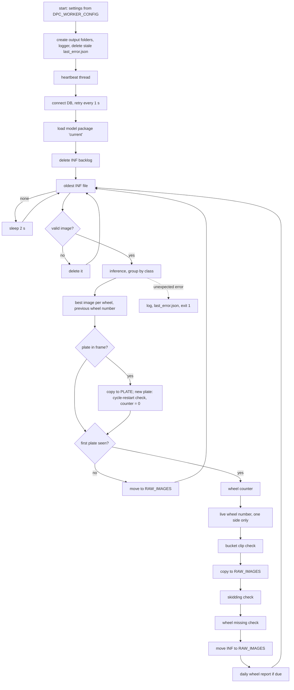

# Inspection worker: the shared program (STATUS P7, D-069)

One program, `inspection.py`, runs twice under the Supervisor: as `inspection_left` (CAM1) and `inspection_right` (CAM2). Each instance reads its rendered config `<root>/config/rendered/inspection_<side>.json` (CONTRACTS 13) from env `DPC_WORKER_CONFIG`.

The logic is that of `LeftAlgorithm.py`, the reference (D-069). Changes are only those decided in D-073 (D3 to D9) and the move from hardcoded values to config. Old line numbers (`L:<n>`, `R:<n>`) and bug numbers (`B<n>`) refer to `LEGACY_ANALYSIS.md`, the P7a analysis of the old files.

`LeftAlgorithm.py`, `RightAlgorithm.py` and the XML examples stay in the repo until Tadipatri runs the new program. They are used by the equivalence test and the replay, and are not run by the Supervisor.

## 1. Files
| File | What it does |
|---|---|
| `inspection.py` | entry point: settings, logger, DB, model, main loop, stop and error exit |
| `settings.py` | reads and checks the rendered JSON; a missing or wrong key stops the program with the key's name |
| `model.py` | model package that `current` points to (sha256-checked, CONTRACTS 12); Detectron2 setup; inference; label mapping |
| `tracking.py` | wheel counter (`motion` rtl / ltr) and plate tracker |
| `check_bucket_clip.py` | full and half bucket clip bolt check |
| `check_skidding.py` | wheel rotation (skidding), magnet-not-seen diagnostics |
| `check_wheel_missing.py` | wheel missing (the reference pattern) |
| `check_cycle_restart.py` | short revolution at a new plate |
| `defects.py` | `defects_table` access and the shared defect steps; live wheel number |
| `wheel_report.py` | best image per wheel and the daily copy |
| `heartbeat.py` | MQTT heartbeat (D-034) |
| `last_error.py` | `<root>/run/<worker_id>.last_error.json` (D-073 D7) |
| `helpers.py` | geometry, image boxes, dated folders, frame-name times |
| `model_selftest.py` | model self-test before a switch (F47, section 12); read-only, not part of the running program |
| `auto_roi.py` | auto region of interest: learning on request, path check, observe / filter, out-of-bound list, drift (P13, section 13) |
| `roi_offline.py` | learns the ROI from saved frames into a chosen folder (P13, section 13); not part of the running program |
| `measure.py` | measure tool for the setup wizard: box sizes per class and the movement direction (S6, section 15); read-only, not part of the running program |
| `live_overlay.py` | annotated preview, plus the plain live frame + detections pair, for the UI every few seconds (F60, F65, section 14) |
| `tests/` | unit tests and the old-vs-new equivalence test (no GPU needed) |

## 2. Flow



## 3. Lifecycle
- **Start** (`inspection.main`):
  1. Read the settings. Create every output folder of `paths` plus `<root>/run`, so `wheel_status_images` exists before F23 lands (D-075).
  2. Logger: `<paths.logs>/<worker_id>.log`, midnight rotation, `log.backup_count`, level INFO as before.
  3. Delete an old `last_error.json` of this worker: the file always describes the last exit.
  4. Log one INFO line `Checks off: ...` (or `none (all checks on)`), D-085. A file without a `checks` block (rendered before F41) adds one WARNING and runs every check.
  5. Start the heartbeat.
  6. Connect to the DB, retrying every second (as before; waiting counts as alive).
  7. Load the model.
  8. Delete the `INF` backlog (unchanged, L:2299-2304).
  9. Start the loop. Nothing is inspected before the first plate.
- **Stop:** SIGTERM or SIGINT. The current frame is finished, then the program exits 0. During the DB wait the stop is immediate.
- **Unexpected error** (D-073 D7), anywhere: the error is logged with its traceback, `last_error.json` is written, and the program exits 1. There is **no in-process restart** any more (old B8). The Supervisor restarts the program under `restart_cost: high`.
  - **Config errors.** A config that cannot be read also writes `last_error.json`. Root and worker id are then taken from the config path `<root>/config/rendered/<worker_id>.json`.
  - **What counts as an unexpected error.** Same set as before: everything that used to restart inspection in-process.
  - **Exceptions logged and not fatal** (unchanged):
    - file move or copy errors for `RAW_IMAGES` and `PLATE`;
    - the live wheel-number write;
    - saving a wheel-missing defect (as in the reference pattern);
    - a DB error inside the dedupe query (it counts as "not found"; the following insert then fails and is fatal).
- **`last_error.json`:** `{at, type, message, where, traceback (last 12 lines)}`. `where` is the deepest line in this program's own code, e.g. `defects.py:62 in insert`, not a line inside pymysql. The DB and MQTT passwords are replaced by `***`. Written atomically.
- **Heartbeat:** `dpc/worker/<worker_id>/health` every 10 s.
  - Fields: `worker_id`, `healthy`, `pid`, `version` (`git describe`), `config_hash` (first 12 hex of `_generated.sha256`), `fps` (frames processed per second over the last 60 s), `inf_queue_depth`, `last_frame_age_s`.
  - Appended in F60 (append-only, D-034):
    - `ms_per_image`: mean time to process one frame, model plus every check, over the last 60 s; null until a frame was processed.
    - `waiting_for_plate`: true until the first plate after a start, while frames are inferred but not inspected.
  - Appended for R6: `model` {name, version} of the running model package; null while it is still loading.
  - Appended for F76 (D-105), set in `_on_plate()` only at a **new** plate (once per physical plate, D-077):
    - `plates_seen`: new plates since the process started.
    - `last_plate_frame`: that plate's frame name.
    - `last_plate_at`: ISO time with UTC offset, when it was processed.
    - `last_cycle_wheels`: wheels counted in the cycle that just ended; `null` for the first plate after a start (nothing is counted before it).
    - Before the first plate: 0 / null / null / null.
    - The transfer service uses them as cycle boundaries; the UI shows "last plate N min ago".
  - `healthy` is false when the main loop has not turned for 60 s, for example a hung GPU call. An empty `INF` still turns the loop.
  - The broker comes from the JSON `mqtt` block (F25; `user`/`password` null = no login). A file without the block (rendered before F25), or no paho-mqtt, means the program logs "Heartbeat off" once and runs without a heartbeat. Inspection never depends on the broker (D-034).

## 4. Settings used (rendered JSON, CONTRACTS 13)
| Key | Used for |
|---|---|
| `worker_id`, `side`, `defect_side`, `camera_id` | log file, heartbeat topic, `last_error` name; `defect_side` = `defects_table.defect_side` (`Left` / `Right`); `side` is the prefix of magnet images |
| `writes_live_wheel_counter` | D3: only this side writes `wheel_counter_table` |
| `checks` {bucket_clip, skidding, wheel_missing, cycle_restart} | D-085: which checks run on this side (section 6) |
| `auto_roi` {mode, margin_px, static_px, ...} | P13 auto-ROI (section 13); keys not yet rendered take their defaults with one WARNING |
| `paths.inf` | work queue |
| `paths.raw` | frames moved out of `INF`; skidding evidence source; best-image paths |
| `paths.defect_raw`, `paths.defective`, `paths.repeated` | defect images (section 8) |
| `paths.plate`, `paths.magnet`, `paths.bolt_data`, `paths.wheel_status_images` | plate frames, magnet-not-seen frames, bolt candidates, daily wheel report |
| `paths.root`, `paths.logs` | `run/` (last_error), log |
| `paths.temp` | not used (the old TEMP folder was never read) |
| `log.backup_count` | log rotation (was hardcoded 7) |
| `model.name`, `model.models_dir` | the package `current` points to |
| `threshold` | `SCORE_THRESH_TEST` (the second fixed 0.5 filter stays, B4) |
| `machine.total_wheel_count` | wheel-count gate of defects |
| `machine.expected_cycle_total` | cycle-restart check (D8; was 65 Left / 188 Right) |
| `wheel_report.daily_time` | time of the daily copy (D4) |
| `object_sizes.bucket_clip_w`, `object_sizes.half_bucket_clip_w` | minimum clip widths |
| `motion` | wheel-counter direction (Left `rtl`, Right `ltr`) |
| `bucket_clip_window`, `half_bucket_clip_window` | clip pixel windows (per side, D5) |
| `tracker.*` | every tracker value (section 5 to 7), per side, today's values (D-073 D5) |
| `tracker.best_image_band_x` | wheel-centre band for the best image per wheel (F25; default 400..850 = Right's R:2981, both sides) |
| `db` | DB connection |
| `mqtt` | heartbeat broker (F25) |

Not used: `object_sizes.wheel_w`, `wheel_h`, `chain_w` (as before), `auto_roi.learn_images` (D-090, replaced by one cycle in D-092), `plc` (inspection never talks to the PLC).

Every value comes from the JSON; the last constant (the best-image band) became `tracker.best_image_band_x` in F25.

## 5. Detection, wheel counting, plate and cycle
- **Detection** (`model.py`), as L:166-239.
  - Mask R-CNN from the package `current` points to: weights, Detectron yaml, `classes.json` order, every file sha256-checked first.
  - `SCORE_THRESH_TEST = threshold`, then a fixed `score > 0.5` filter (B4).
  - Output per object: `[score, ymin, ymax, xmin, xmax, class_name]`. Masks are not used.
  - Label mapping: the package `label_map`, then the old `changeLabelName` mapping (`dusty_*` and others; none of these names is a Tadipatri class).
  - Detections are grouped by mapped name and keep the model's own name at index 5, as before.
- **Wheel counter** (`tracking.WheelCounter`), on `wheel` + `half_wheel`.
  - `rtl` (Left, L:1775-1818): the leftmost `xmin` with a low watermark. A new wheel when `xmin` > watermark + `tracker.new_wheel_jump_px`.
  - `ltr` (Right, R:1906-1935): the rightmost `xmax` with a high watermark. A new wheel when `xmax` < watermark − jump.
  - The watermark is never cleared, not even at a plate (B6).
- **Plate** (`tracking.PlateTracker`, D-077): the same watermark rule as the wheel counter, in the same `motion` direction, with `tracker.new_plate_jump_px`. One physical plate = one new plate.
  - `ltr` (Right): the rightmost `xmax`, high watermark; new when it drops more than the jump below it. Unchanged (L:2208-2243).
  - `rtl` (Left): the leftmost `xmin`, low watermark; new when it rises more than the jump above it. Before D-077 Left used the `ltr` rule (B5): a plate moving left was "new" again every 150 px of travel, which reset the cycle several times and gave false `Batch_Wheels_Missing` at wheel 1.
  - Every frame with `plate` or `plate_area` is copied to `paths.plate`.
  - At a new plate: the cycle-restart check (section 6), counter = 0, and this frame's wheels are ignored.
- **Before the first plate:** frames are inferred, then moved to `RAW_IMAGES` without counting or checks.

## 6. Checks
**Switches (D-085, F42).** Each check can be off per side through `checks` in the JSON (`site.yaml` `inspection.checks`, per-side override `inspection.sides.<SIDE>.checks`).
- A check that is off is **not built and not run**: no images, no defect rows, no mails from it.
- Its own side files stop too: `bolt_data` copies with `bucket_clip`; magnet-not-seen images with `skidding`.
- Everything else is unchanged. Wheel counting, plate and cycle reset, the best image and the live wheel number always run. With `cycle_restart` off only the `Batch_Wheels_Missing` check stops, not the reset.
- Unknown names or non-boolean values stop the program at start (a typo must not leave a check running).
- A name missing from the block means on.
- No block at all (file rendered before F41) means all on, with one WARNING.
- Code is never edited on a site to switch a check off.

- **Full bucket clip** (`check_bucket_clip`, L:598-764, unchanged).
  - Candidate: width > `bucket_clip_w`, inside `bucket_clip_window`, no `high_dusty_bucket_clip` within `tracker.high_dusty_suppress_px`.
  - Bolts: `nut_bolt` centre x between the clip's xmin and xmax.
  - Fewer than 2 bolts: the frame is copied to `paths.bolt_data` (B10), and the candidate is buffered per frame name.
  - Confirmed when `clip_confirm.frames` candidates have at least `min_pairs` consecutive pairs below `max_gap_ms` and `max_dist_px`. The centroid argument order is kept (B2).
  - The buffer is cleared only after an insert (B11). Wheel-count gate applies.
- **Half bucket clip** (L:766-886, unchanged). Checked only when a `half_high_dusty_bucket_clip` is detected (B3); that class is not in the Tadipatri model, so it never runs there. When it runs: window `half_bucket_clip_window`, width > `half_bucket_clip_w`, fewer than 1 bolt = defect at once, no wheel-count gate.
- **Skidding** (`check_skidding`, L:1246-1604, detection unchanged; reporting new, D9).
  - Magnet matched to its wheel; reference point = a `wheel_bolt` in the wheel, else the wheel centre + `offset_px`.
  - The track resets on:
    - a time gap of `time_gap_reset_ms` or more;
    - another wheel;
    - a wheel that did not move (belt stopped: never a defect);
    - a vertical magnet jump.
  - Over `window_frames` frames on a wheel inside `wheel_xmin..wheel_xmax`, a magnet travel below `min_magnet_travel_px` = `Wheel_Skidding`, reported through the shared steps (section 7).
  - The last up to 6 frames are copied as evidence into `DEFECTIVE/<date>/<time>/`, **only for a new defect**. Before, they were copied every time.
  - With no magnet, a `wheel` wider than `magnet_check_min_wheel_w` is saved to `paths.magnet/<date>/<SIDE><wheel>_<time>.jpg` (diagnostics, not a defect).
- **Wheel missing** (`check_wheel_missing`, the reference pattern = L:1919-2092 with the insert, D9).
  - Per wheel number, frames with no wheel are counted and buffered.
  - A gap of `min_frames`..`belt_stop_frames` frames is `WheelMissing`, judged when a wheel appears again or the counter moves to the next number. More frames = belt stopped, cancelled.
  - Box `tracker.wheel_missing.bbox`.
  - `is_reported` is never reset (D-073 D9 note): each wheel number is reported at most once per process run (B7).
- **Cycle restart** (`check_cycle_restart`, D9). At a new plate, when the revolution that ended counted more than 0 but fewer than `expected_cycle_total` wheels: `Batch_Wheels_Missing`, wheel number = last count, box (0, 0, 0, 0). The image is a copy of the plate frame. Longer cycles are not reported (as before).
- **Wheel stand:** off. The old fixed maps are not carried over; P10b builds the learned version (D8).
- **Not carried over (never called before):** chain, gap and wheel-bolt checks, the cropped second model, `is_plate_detected`, the stand logic; Right's `checkCroppedImg` and `saveAndInsertDefect`. They stay in the old files and in git history (LEGACY_ANALYSIS.md 7.3).

## 7. Defects (`defects.DefectStore.record`, the D9 pattern)
For every type, in this order:
1. **In-memory repeated check.** The list is empty: the `repeated_defects_table` lookup stays disabled, L:2340.
2. **Otherwise the 24 h dedupe** (same wheel + type + side; the size condition compares the box with itself, D-044), and, where the check asks for it, `wheel <= total_wheel_count`.
3. **New:** `defect_raw/<YYYYMMDD>/RAW_<time>_<type>_<wheel>.jpg`, then the boxed image `defective/<YYYYMMDD>/<time>_<type><wheel>.jpg`, then the `defects_table` row (side, type, image path, wheel, box). Images come before the row (CONTRACTS 4.1).
4. **Otherwise** both images go to `repeated/<YYYYMMDD>/<wheel>/`.

| Type | Check | Wheel gate | DB row before P7 | Now |
|---|---|---|---|---|
| `Nut_Bolt_Missing_In_Bucket_Clip` | full clip | yes | Left only (Right's insert was commented out) | both sides (D6) |
| `Nut_Bolt_Missing_In_Bucket_Clip` | half clip | no | (unreachable) | both sides (unreachable at Tadipatri) |
| `Wheel_Skidding` | skidding | yes | no, images only | yes (D9) |
| `WheelMissing` | wheel missing | yes | no, images only | yes (D9) |
| `Batch_Wheels_Missing` | cycle restart | yes | no, image `RESTART_AT_<n>.jpg` | yes (D9) |

The mail sender sends every unsent row of any type, so all of them are now mailed. The INSERT uses parameters since F60 (the driver quotes the values); the dedupe SELECT text is unchanged (f-string, B14). Boxes accumulate on the frame when one frame has several defects (B12).

**Live wheel number (D3):** the side with `writes_live_wheel_counter: true` writes row ID 1 with `INSERT INTO wheel_counter_table (ID, WHEEL_COUNT) VALUES (1, %s) ON DUPLICATE KEY UPDATE WHEEL_COUNT = VALUES(WHEEL_COUNT)` (F75: an upsert, so a DB without row 1 gets it; before, an `UPDATE ... WHERE ID = 1` changed nothing on Tadipatri's unseeded DB) whenever its counter changes, including 0 at each plate, as R:2782-2803 and R:3093-3095. Tadipatri: Right.

**Daily wheel report (D4, both sides):**
- For every `wheel` detection, the frame becomes the best image of the previous frame's wheel number (as R:2957-3015) when the wheel centre is inside `tracker.best_image_band_x`, or when the previous best image is gone.
- During the minute of `daily_time`, the list is written to `wheel_status_images/wheel.txt` and each best image is copied to `wheel_status_images/<YYYY-MM-DD>/wheel_<n>_<frame>.jpg`.
- Fix (D4): a best image that no longer exists, or the empty initial entry for wheel 1, is skipped with one warning instead of crashing.
- Unchanged: a day with no frame during that minute has no report.

## 8. Files and folders
- `INF` files are read (`imread`), copied from (`bolt_data`, `PLATE`, `RAW_IMAGES`), moved (to `RAW_IMAGES`) or deleted. They are never modified in place (D-031, Q12).
- Every image write creates a new file in an output folder.
- Output folders are created at start when missing.

## 9. In-memory state (lost on every restart)
| State | Where | Effect when lost |
|---|---|---|
| first plate seen | `Inspection.plate_found` | no inspection until the next plate (up to one revolution) |
| wheel counter, watermark | `WheelCounter` | numbering restarts at the next plate |
| plate watermark | `PlateTracker` | next plate counts as the first |
| clip candidates | `BucketClipCheck.candidates` | a confirmation in progress needs new frames |
| skidding track, evidence names | `SkiddingCheck` | 3 new frames needed |
| wheel-missing slots incl. buffered frames, `is_reported` | `WheelMissingCheck.history` | gaps in progress forgotten; reported wheel numbers can be reported again |
| best image per wheel | `WheelReport.best` | the next daily report holds only images seen since the start |
| last live wheel number written | `Inspection.live_counter_written` | written again at the first change |
| wheel detections list | `Inspection.wheel_present` | grows forever, never read (B9, kept) |
| `INF` backlog | folder | deleted at every start (unchanged) |

## 10. Bugs and oddities: what P7 changed and what stays
- **Changed by D-073:**
  - **B1:** skidding, wheel missing and cycle restart now create rows (D9).
  - **B8:** no in-process restart (D7). Hardcoded paths are gone, so the Maihar-path crash cannot happen.
  - **B13:** config errors are named, and the program stops at start.
  - **B16:** cycle total from config (D8).
  - **R2:** the best-image crash is fixed (D4).
  - **R7/R8:** gone; both sides run the same code.
  - **B5:** fixed by D-077 (P7-fix): the plate tracker follows `motion`.
- **Kept on purpose** (developer instruction, P7): B2, B3, B4, B6, B7 (`is_reported`, D9 note), B9, B10, B11, B12, B14 (dedupe SELECT only; the INSERT uses parameters since F60), B17 (log texts), B19 (each frame decoded twice).
- **New observation, kept:** a frame is deleted as invalid when it is less than 0.03 s old (L:503-526, `is_valid_image`). With the atomic hand-off (D-031) a fresh `INF` link can be that young, so a frame can be lost. It is rare at 4 fps. Fix: skip the frame instead of deleting it; developer decision.

## 11. Tests
- **`python3 -m unittest discover -s workers/inspection/tests -t .`** (repo root, no GPU, no DB): 100 tests; the 2 real-DB tests of `test_live_counter.py` run only with `DPC_TEST_DB=host:port:user:password` (scratch database `dpc_f75_test`, created and dropped), otherwise they are skipped.
  - Settings from the real renderer: Tadipatri per-side values; a missing key is named.
  - Wheel counter in both directions; plate tracker: one plate crossing = one new plate, on both sides (D-077).
  - D-077 through the real frame flow: a plate crossing the Left camera with a wheel in view gives one reset and no `Batch_Wheels_Missing`; the next plate gives one, with the right count. (With the old B5 rule the same test gives 4 resets and a false restart at wheel 1.)
  - `tracker.best_image_band_x` read from the JSON and used by the best-image choice.
  - Clip confirmation per side, half-clip rule.
  - Wheel missing: gap, short gap, belt stop, previous slot.
  - Skidding: skid, rotating wheel, stopped belt.
  - Cycle restart, defect store (new / duplicate / gate), daily report skip.
  - The frame flow with a fake detector (plate gating, moves, live counter on Right only).
  - `last_error.json` (scrubbed, config-error case, `where` in own code), heartbeat payload.
  - Check switches (`test_checks.py`, D-085). One scripted Left scenario of 1,200 frames produces all four defect types through the real frame flow and `DefectStore`. With each check off: no rows and no images of that type, no `bolt_data` / magnet files where they belong to it, and **the other checks' rows identical** to the all-on run. Explicit all-on = default. Settings: missing block, missing name, unknown name, non-boolean; start log lines.
- **`test_equivalence.py`:** the old functions of `LeftAlgorithm.py` / `RightAlgorithm.py` (Detectron2 stubbed) and the new classes get the same random detection sequences. Results are identical for:
  - wheel counter (3,000 frames, both directions); plate on Right against the old plate code; plate on Left against the old Left *wheel* rule fed with plates, which is what D-077 asks for (the old Left plate code is B5, deliberately different now);
  - bucket-clip inserts (6,000 frames per side; Right compared with its saved images, since its insert was commented out);
  - wheel-missing slots;
  - skidding findings.
- **`tests/replay/replay_inspection.py`** (site machine, GPU): the same saved frames through the old program and the new one, each with a scratch DB. Bolt defects are compared and new types listed.
  - The old program comes from git, with paths redirected to `/tmp`, and with the deliberate changes applied to the scratch copy: D-077 (plate rule) on LEFT, D6 (insert on) on RIGHT.
  - See `tests/replay/README.md`.
- **Smoke tests on 2026-10-26** (real MariaDB, real mosquitto, scripted fake detector, 900 frames per side):
  - Replay LEFT PASS: 23/23 bolt defects, plus 6 `WheelMissing` and 6 `Wheel_Skidding`.
  - Replay RIGHT PASS: 15/15 bolt defects, plus 1 `WheelMissing` and 5 `Wheel_Skidding`.
  - Heartbeat received from the broker and accepted by the Supervisor's `parse_heartbeat` with all extended fields.
  - SIGTERM: exit 0, no `last_error.json`.
  - `defects_table` gone mid-run: exit 1, `last_error.json` with `ProgrammingError` at `defects.py:62 in insert`, no password in it.
  - DB down at start: the program waits and retries (does not exit).

## 12. Model self-test (F47, for P11 model switching)
`python3 workers/inspection/model_selftest.py --model <name> --version <v> --frames <folder> [--count 5] [--threshold 0.5] [--models-dir <dir>] [--json]`

The Supervisor runs it before moving `current` (D-056, D-060). Per model name, so per side when the sides use different models (D-086).
- **Package:** loads `<models_dir>/<name>/<version>/`, default `<root>/data/models` with `<root>` from the code location (CONTRACTS 4.1). Every file's sha256, and the name and version, are checked by `common/config/model_package.verify_package`. A corrupt package fails before the model is loaded.
- **Inference:** runs the same `model.Detector` as inspection (same 0.5 filter, same label mapping, `model.map_label`) on the newest N `.jpg` frames of the folder, by name = capture time. Prints one line per frame, e.g. `2026_11_03_10_00_06_000000.jpg: bucket_clip=1, nut_bolt=2, wheel=1`, or `no detections` / `unreadable, skipped`.
- **Exit 0:** the package loads and at least one `wheel` is found (`half_wheel` does not count). Last line `SELFTEST PASS: <name> <version>, <n> frame(s), <k> 'wheel' detection(s)`.
- **Exit 1** with `SELFTEST FAIL: <reason>`, for any of:
  - package not usable (missing version, checksum mismatch, name/version mismatch);
  - frames folder missing or without `.jpg`;
  - every frame unreadable;
  - model does not load (Detectron2, CUDA);
  - inference error;
  - no `wheel`.
- **`--json`** adds one JSON line `{model, version, frames, totals, pass, reason}` for the Supervisor.
- **Read-only:** no DB access (pymysql is never imported), no file is moved, deleted or written, and `current` / `pinned` are never touched.
- **GPU:** it uses the GPU while it runs, next to live inspection. Fine for 5 frames; the Supervisor runs it at a quiet moment anyway, like the switch.
- **Tests:** `tests/test_model_selftest.py`, with a real package check and a fake predictor. Covers pass with counts, newest-N selection, no wheel, label map, corrupt package, missing version or frames, load error, unreadable frames, read-only snapshot of frames and models, and the CLI exit codes / `--json` / no pymysql in a fresh process.

## 13. Auto region of interest (P13; D-054, D-090, D-091, D-092)
On the conveyor every object of a class travels along a fixed path: at a given x it is always at about the same y. The region of a class is that path y(x) with a band around it, learned per side. `auto_roi.py` runs **inside the running inspection**: it uses the detections inspection already made, so no extra model run and no change to the checks.

**Learning, only on request (D-092 item 1).**
1. A person (later the UI) creates `<root>/run/inspection_<side>.roi_learn`; the content doesn't matter.
2. From the next plate to the following plate (one cycle), every detection of a frame in which **the conveyor moved** is kept. Moved means the wheel edge the side's counter follows (`rtl` leftmost `xmin`, `ltr` rightmost `xmax`) advanced by at least `min_wheel_step_px`, or a new wheel took over. Frames without a wheel, or with a wheel that didn't move, are not used; there is no per-object tracking.
3. At the second plate, per class:
   - **Stationary repeats are dropped:** a box location that recurs within `static_px` in more than `static_share` of the used frames (reflection, stain, mark).
   - **Robust line:** a Theil-Sen line of the box centres (y over x); boxes with residual > `mad_factor` × MAD are dropped.
   - **Grid:** `grid_steps` + 1 points over the frame width (11 at 1920 px: 0, 192, … 1920). Per point, the boxes whose centre is within ± half a step give `y_min` = `top_percentile` of the top edges − `margin_px` and `y_max` = `bottom_percentile` of the bottom edges + `margin_px`. On a slanted path the band therefore also covers the slope across the 192 px window (slope × 96 px each side).
   - **Gaps:** a point with fewer than `min_per_point` boxes takes its values from the neighbours.
   - **`x_range`:** 1st–99th percentile of the centres ± `margin_px`: where the class was seen while learning. **Information only, never a limit** (D-094). Stored points beyond the measured ones continue along the line slope (no flat clamp).
   - **Not learned:** a class without any point with enough boxes is stored as not learned and is **never filtered**. `plate` is the usual one, seen once per cycle.
4. Files in `<root>/data/state/inspection_<side>/`, written atomically:
   - `roi.json`. A previous one is first copied to `roi.prev.json`, so `roi.json` is never missing.
   - Preview images (F56) `roi_preview_<NN>_<classA>__<classB>.jpg`, one per `preview_classes_per_image` (2) learned classes in name order; the last may have fewer.
     - Each band is drawn as its top and bottom line plus a light fill, over the full width, in two clearly different colours (yellow, magenta), with a legend of the names ("seen at x …" = `x_range`) and the classes not learned as text.
     - The frame is a real frame of the cycle that shows those classes if possible. While learning, a frame is kept only when it shows a class not yet covered, so only a few frames are held in memory.
     - The side's old previews (`roi_preview_*.jpg`, and the single `roi_preview.jpg` from before F56) are removed first.
     - `roi_status.json` lists their names under `roi.previews` for the UI.
   - The request file is then deleted, and event `roi_learned` (or `roi_learn_failed`) is published.
5. No second plate within `learn_max_frames`: given up, WARNING, `roi_learn_failed`, request deleted, nothing written.
6. Learning lives only in memory: after a restart the request file is still there, so learning starts again at the next plate. **Nothing ever relearns automatically.**
7. Learning works in every mode.

**`roi.json`:**
```
{schema_version: 1, side,
 learned_from: {camera_id, model {name, version}, frames_seen, frames_used, frame_size [w, h], started, time},
 settings: {margin_px, static_px, static_share, min_per_point, grid_steps, top_percentile, bottom_percentile, mad_factor, min_wheel_step_px},
 classes: {<class>: {learned: true, x_range [a, b], points [[x, y_min, y_max], ...], boxes, dropped_static, dropped_outliers, line {slope, intercept}, used_boxes, measured_points}
           | {learned: false, reason, boxes, dropped_static}}}
```
- Read at start and right after learning.
- An unreadable file, or a different frame size, is logged and ignored: nothing is checked, never a crash.
- A model change doesn't invalidate it (D-090); `learned_from` is information only.

**Using it (`auto_roi.mode`).** Only y is restricted, never x (D-094, F54): the conveyor moves through the whole image, so every x is valid. A detection is outside only when, at its centre x, its box top < `y_min` or its box bottom > `y_max`. Distance outside = the larger overshoot in px.
- The band is linear between the stored points.
- Beyond the outermost stored point it continues along the class's robust line slope (`line.slope` in `roi.json`) with that point's band height. So it covers the full frame width, with no flat clamp and no cut-off.
- Existing `roi.json` files need no relearn: the stored points stay valid.
- **`off`:** nothing is checked.
- **`observe` (default):** every detection of a learned class is checked, **nothing is removed**: defects are identical to `off` (tested). Cost per detection: a few comparisons.
- **`filter`:** off-path detections are removed right after grouping, **before everything that uses detections** (plate, wheel counter, best image, all checks). Switched on by a person in `site.yaml` after looking at the preview and the out-of-bound list (D-054, D-092 item 4).
- Without `roi.json`, every mode behaves like `off`.

**Out-of-bound checker for the UI (D-092 item 3), in `observe` and `filter`.**
- `roi_outside.jsonl`: one line per off-path detection, `{time, frame, class, box, score, distance_px, mode, crop}`, with a crop image (box + `outside_crop_pad_px`) in `roi_outside/`.
  - Kept to the last `outside_keep` entries; trimmed at 120 %, crops of trimmed entries deleted.
  - At most `outside_max_per_minute` entries are written per minute. Beyond that, detections are still counted (`not_listed_rate_limit`), so a bad ROI can never slow inspection.
- `roi_status.json`: rewritten every 100 frames and at stop. Holds mode, ROI (time, learned and not-learned classes), learning state, per class `inside` / `outside` counts, recent outside ratio and drift flag, and the list size.
- **Drift:** per class, over the last `drift_window` **moving detections**. Above `drift_ratio` outside: one WARNING and event `roi_drift` {side, class, ratio, window}; reported again only after it was back below. Never acted on.
  - Moving = learning's rule (F55): the frame's wheel moved, and the detection is not a stationary repeat. A stationary repeat is a box location seen within `static_px` in more than `static_share` of the class's last `drift_window` moving frames, judged once 10 frames are known.
  - A stationary off-path object (a fixed part, a stain) is still counted and listed as outside, but never raises drift. Seen on Tadipatri RIGHT `half_bucket_clip`.
- Events go on `dpc/worker/inspection_<side>/event` (CONTRACTS 2) through the heartbeat's MQTT client (best effort).
- Any error in the ROI part is logged and skipped for that frame; inspection continues.

**Offline:** `python3 workers/inspection/roi_offline.py --side LEFT --frames <saved frames> --out <folder> [--version <v>] [--whole] [--limit N]` runs the model on saved frames and the same calculation (first plate to next plate, or `--whole`), and writes `roi.json` + the preview images to `--out` only. It is read-only for the site and uses the GPU, so run it at a quiet time.

**Keys** (`inspection.auto_roi`; missing ones take these defaults with one WARNING until CONFIG renders them):
`mode` observe, `preview_classes_per_image` 2 (F56), `margin_px` 100, `static_px` 3, `static_share` 0.2, `min_per_point` 30, `grid_steps` 10, `top_percentile` 1, `bottom_percentile` 99, `mad_factor` 3, `min_wheel_step_px` 5, `learn_max_frames` 8000, `outside_keep` 500, `outside_crop_pad_px` 30, `outside_max_per_minute` 60, `drift_window` 200, `drift_ratio` 0.2. `learn_images` is no longer used.

**Tests** (`tests/test_auto_roi.py`, 24):
- **Calculation:** slanted path points against the true line (window rule included); a fixed false detection plus rare off-line boxes removed; too few boxes = not learned and never filtered; a sparse grid point interpolated; movement judged in both directions (stop, move, new wheel).
- **Learning:** request → files → request deleted → `roi.prev.json` on relearn; no request = nothing; stopped-belt and no-wheel frames ignored; give-up without a second plate.
- **Using:** filter drops an off-path box and leaves unlearned classes alone; the observe list fills, is trimmed and has matching crops; status counts; rate limit; drift reported once; `off`, unreadable file and other frame size ignored.
- **Observe = identical defects** through the full frame flow (1,200-frame scenario with learning on request and injected off-path bolts), and those bolts appear in the out-of-bound list.
- **The offline tool** learns exactly what live learning learns.
- **Settings:** defaults and errors.
- **y only (F54):**
  - A box at the image edge, beyond the learned x range, is inside when its y is in the band and outside when it is not, on both edges.
  - The band continues along the slope with the outermost band height.
  - A roi.json in the P13 format stays valid.
  - The preview band covers the full width.
- **Drift on moving detections (F55):** off-path detections moving with the chain raise drift once; a stationary off-path object is counted and listed, but never drifts. Without F55 that test fails.
- **Pair previews (F56):** file names for 2 classes per image and for 1 per image; old previews removed; two distinct colours; lines plus a light fill; a frame showing both classes preferred.

## 14. Live overlay for the UI (F60, D-098 item 6)
Every 3 s (`live_overlay.OVERLAY_INTERVAL_S`) inspection writes `<root>/data/state/inspection_<side>/live_overlay.jpg`, atomically (temp file, then rename). It is the frame just processed, downscaled to 960 px wide (camera aspect ratio kept), with:
- **Detection boxes** in their class colour, with the class name. Colours are fixed and clearly different for the main classes (wheel white, bucket_clip yellow, half_bucket_clip orange, nut_bolt magenta, wheel_magnet green, …) and never red.
- **The auto-ROI band** (top and bottom line) of each class present in the frame, when a `roi.json` for this frame size exists.
- **Off-path detections in red**, thicker: removed in `filter` mode, only marked in `observe` mode. The legend says which.
- **A legend:** side, wheel number, auto-ROI mode, time, number of detections and how many off path, and "WAITING FOR PLATE" before the first plate.

The overlay uses the detections before auto-ROI filtering plus the frame's off-path list, drawn on a copy, so it never changes a detection or a defect. Cost: one downscale and a few rectangles every 3 s. Any error is logged and skipped.

Tests (`tests/test_live_overlay.py`, 5): heartbeat fields (null before frames, mean after, append-only order); drawing (red off-path box, class colour box, band line, legend, 960 × 540 output, no red among class colours, main classes distinct); writer interval and atomic file; the real frame flow writes the overlay with the off-path box in red. The parameterised INSERT has its own test in `test_inspection.py`.

**Live frame + detections, as a pair (F65).** In the same 3 s step, so the UI can draw only the classes a person selects:
- `live_frame.jpg`: the same frame downscaled to 960 px wide, **no drawing**.
- `live_detections.json`:
  ```
  {frame, time, seq, size [w, h] of live_frame.jpg, frame_mtime_ns,
   boxes [{class, box [x1, y1, x2, y2] in live_frame pixels, score, off_path}],
   bands {class: [[x, y_min, y_max], ...] in live_frame pixels}, auto_roi_mode}
  ```
  - **Boxes** are the detections **before** auto-ROI filtering, every class; `off_path` true = removed in `filter` mode, only marked in `observe`.
  - **Bands:** every learned class, over the full width (D-094: the frame edges plus the stored points), when a `roi.json` for this frame size exists; otherwise `{}`.
- **Matching pair:** `live_frame.jpg` is replaced first and `live_detections.json` last, each atomically. The JSON names the image file's `frame_mtime_ns`. A reader that finds a different mtime on `live_frame.jpg` has caught the next pair halfway, and reads again. `seq` counts the pairs since start.
- `live_overlay.jpg` (F60) is still written as before.

Tests (`tests/test_live_overlay.py`, now 10): additionally boxes and bands scaled to the live frame (1920 → 960), `off_path` flags, no bands without `roi.json`; the pair written together (skipped steps write neither, `frame_mtime_ns` and `size` match the image, no drawing on `live_frame.jpg`); the frame flow writes the pair with the frame name; heartbeat `model` field (null, then set, last key).

## 15. Measure tool for the setup wizard (S6; D-103 steps 3 and 7, D-077, D-086)
`python3 workers/inspection/measure.py --frames <folder> (--side LEFT | --model <name>) [--version <v>] [--count 40] [--threshold 0.5] [--models-dir <dir>] [--json]`

Runs a model package on the newest N `.jpg` frames of a folder: the live `RAW_IMAGES`, or the frames the wizard grabbed. The model package is chosen like this:
- **`--side`** takes the model name and threshold from `inspection_<side>.json` (per-side models, D-086); **`--model`** names it directly.
- Without `--version`, the version `current` points to.
- sha256-checked, using the same `model.Detector` and label mapping as inspection.

The tool returns:
1. **Sizes:** per class the median width and height, the 10th / 90th percentiles and the number of boxes, plus an **`object_sizes` proposal** from the medians: `wheel_w` / `wheel_h` (wheel), `bucket_clip_w`, `half_bucket_clip_w`, `chain_w` (first of `chain`, `bottom_chain`, `top_chain` the model has). A key whose class was not seen is `null`.
   - **Note:** the checks use `bucket_clip_w` / `half_bucket_clip_w` as a **minimum** width (a clip must be wider). The median itself would reject about half the clips. The wizard should propose a value below it, e.g. the 10th percentile or 0.9 × median. The person confirms (D-103 step 7).
2. **Direction:** `rtl`, `ltr` or `unknown`, from the full `wheel` boxes (half wheels are cut at the image edge) over consecutive frames.
   - **Matching:** each wheel is matched to the nearest wheel of the next frame within half a wheel width; frames more than 2 s apart are not paired.
   - **Steps:** steps under 3 px count as not moving.
   - **Decision:** at least 5 moving steps, of which at least 80 % in the same direction. Negative x steps = `rtl`, positive = `ltr`.
   - **Evidence:** frames with a wheel, frame pairs, wheel steps, moving steps, mean and median x step, consistency, and the reason.
   - **`unknown`:** returned when the conveyor stood still, there were too few frames, or the steps disagree. D-077: never assumed; the wizard shows the evidence and a person confirms.

**Read-only:** no DB access (pymysql is never imported), no file written, moved or deleted, `current` untouched. Exit 0 when the measurement ran (the direction may be `unknown`), 1 with the reason otherwise. `--json` prints the result only.

**Tests** (`tests/test_measure.py`, 11, fake predictor):
- **Direction:** rtl and ltr with consistency 1.0 and a ±60 px mean step; a stopped belt gives `unknown`; a short stop plus wrong wheel boxes still gives `rtl`; disagreeing steps give `unknown`; frames 5 s apart are not paired.
- **Sizes:** medians, percentiles, proposal with the `chain_w` fallback and `null`.
- **The whole run on both directions** (like Tadipatri LEFT rtl / RIGHT ltr): direction, sizes, newest 40 of 50 frames, model name and version.
- **Errors:** bad version, no frames.
- **Read-only snapshot.**
- **`--side` settings from the rendered JSON.**
- **CLI `--json`** and exit codes in a fresh process without pymysql.
