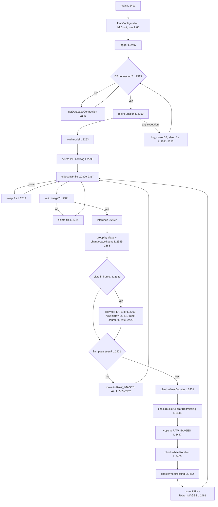

# Inspection worker: how the code really behaves (STATUS P7a, D-069)

Read-only analysis, written by W-inspection on 2026-10-25 from `main` at commit `8ec08b7`. No code was changed.

- `LeftAlgorithm.py` (2,527 lines) is the reference (D-069) and is described in full. References are `L:<line>`.
- `RightAlgorithm.py` (3,243 lines) is described only where it differs from Left (section 14). References are `R:<line>`.
- Only the repo copies are analysed. Code under `~/INSIGHTZZ/old/` on the site machine is not a reference (developer decision, 2026-10-25; section 15).
- "assumed" means not visible in the code read here.

Headline findings (details in the sections named):

1. **Only one defect type ever reaches `defects_table` on Left: `Nut_Bolt_Missing_In_Bucket_Clip` for full clips (L:732).** Wheel skidding, wheel missing, cycle restart and stand counts save images only; bolt-missing, gap and chain checks are not called (section 8).
2. **Right writes no defect rows at all** (full-clip insert commented out R:843; the half-clip insert R:982 would crash) (section 14).
3. **The half bucket clip check can never run** with the current model: it needs a `half_high_dusty_bucket_clip` detection, a class the 19-class model does not have (L:777-786, section 7.2).
4. **Any exception in a check restarts inspection inside the same process**: model reload, `INF` backlog deleted, all state lost, wait for the next plate (section 2.4).
5. `start.txt` and `INPUT_IMG_DIR` are not used by either side (section 12).

---

## 1. Overview

One Python process per side. Left reads the CAM1 `INF` folder, oldest file first, runs Detectron2 Mask R-CNN on the GPU, groups detections by class, tracks the plate (cycle start) and the wheel number, runs the bucket-clip bolt check, the wheel-rotation (skidding) check and the wheel-missing check, saves defect images and inserts confirmed bucket-clip defects into `defects_table`, then moves the frame to `RAW_IMAGES`.

## 2. Lifecycle

### 2.1 Startup
1. Module import selects GPU 0 (`CUDA_VISIBLE_DEVICES='0'`, L:24-25) and imports Detectron2 (L:27-33).
2. `loadConfiguration()` reads `leftConfig.xml` from the working directory (L:91-92), by position (L:101-137). On any error it only prints the traceback (L:139-140) and continues with a partial map; the next line that needs a missing key then fails (for example `LOG_FILE_PATH` at L:2499, which kills the process before the logger exists).
3. Logger "Insightzz", level INFO (L:2497-2498), file `<LOG_FILE_PATH>LeftAlgorithm.log` (L:2499), rotated at midnight, **7 backups hardcoded** (L:2501-2502; `LOG_BACKUP_COUNT` from the XML, L:103, is ignored). `logger.debug` lines (for example L:764, L:1814) are never written at INFO.
4. DB connection loop: connect (L:2514), retry every 1 s on failure (L:2521-2525).
5. `mainFunction()` loads the model (L:2253, section 4), then **deletes every `.jpg/.jpeg/.png` in `INF`** (L:2299-2304), then initialises all state (L:2264-2297).
6. **Waiting for the first plate:** every frame is still read and run through inference (L:2330-2337), but until `isPlateFound` becomes true (L:2405-2406) the frame is moved to `RAW_IMAGES` and skipped (L:2421-2428). No wheel counting, no checks.

### 2.2 Main loop (one frame per pass)
1. List `INF`, sort by name (= capture time), take the oldest (L:2309-2317). Empty folder: log and sleep 2 s (L:2312-2315).
2. `checkIsValidImage` (L:503-526): file exists, modified more than 0.03 s ago, size > 0, `cv2.imread` works. Invalid: delete it (L:2322-2328). The image is decoded here and again at L:2330.
3. Inference (L:2335-2337): `im_copy` is kept clean for the rotation check, `im` is drawn on by the defect functions.
4. Detections grouped by class name after `changeLabelName` (L:2345-2352); lists picked out (L:2366-2385).
5. Plate handling (L:2389-2428, section 6).
6. Wheel counter (L:2431, section 5).
7. Bucket clip check (L:2444, section 7.1/7.2).
8. Copy the frame to `RAW_IMAGES` (L:2447): the rotation check needs the current frame there to copy evidence from (L:1575-1580).
9. Wheel rotation check on `im_copy` (L:2450-2456, section 7.5).
10. Wheel missing check (L:2462, section 7.6).
11. Move the frame from `INF` to `RAW_IMAGES` (L:2479-2484); this replaces the copy from step 8.

### 2.3 Shutdown
No signal handling, no cleanup, nothing persisted. The process ends only when killed (assumed SIGTERM/SIGKILL from the Supervisor or systemd). All state in section 9 is lost.

### 2.4 Crash behaviour (important for D-068 and `restart_cost: high`)
- `checkBucketClipNutBoltMissing`, `checkWheelRotation` and `checkWheelMissing` re-raise every exception (L:888-891, L:1601-1604, L:2089-2092). `mainFunction` re-raises (L:2487-2489).
- `main` catches it, closes the DB, sleeps 1 s, reconnects and calls `mainFunction` again (L:2521-2525, L:2513-2519). **This is a full restart inside the same process:** a new `InferenceClass` is built (model loaded again, L:2253), the `INF` backlog is deleted again (L:2299-2304), all per-run state is reset and inspection waits for the next plate. Only `latest_image_name_list` (module global, L:47) survives.
- `runInference` returns `None` on error (L:238-239); the unpack at L:2337 then raises `TypeError`, which takes the same restart path.
- `checkIsDefectAlreadyGenerated` swallows DB errors and returns False (L:498-500), so a lost DB connection shows up at the following `insertDefectData`, which raises (L:374-376) and restarts.
- The process itself never exits on these errors, so the Supervisor sees it as running; only the log shows the restart ("Model Loaded..." L:192 appears again).

## 3. Inputs and outputs

### 3.1 Folders and files
| What | Path source | Operation | Lines |
|---|---|---|---|
| Work queue | XML `INF_IMAGE_DIR_PATH` | list, read (`imread`), delete invalid, delete all at start, move to RAW_IMAGES | L:2254, 2299-2304, 2309, 2321-2330, 2481 |
| Processed frames | **hardcoded** `dailyDataDir` = `.../CODE/FRAME_CAPTURE/CAM1/RAW_IMAGES/` | copy (L:2447) then move (L:2481); also skipped frames (L:2425) | L:2257 |
| Same folder, read | **hardcoded** `SOURCE_IMAGE_DIR` (same path) | copy last up-to-6 frames as skidding evidence | L:45, 1575-1580 |
| Plate frames | **hardcoded** `PLATE_IMG_OUTPUT_DIR` `.../TEMP_IMG_DIR/PLATE_DIR/LEFT/` | `copy2` of every frame containing `plate`/`plate_area` (the log says "moved", it is a copy) | L:2258, 2389-2398 |
| Bolt candidates | **hardcoded** `bolt_save_dir` `.../bolt_data_left` | `copy2` of the frame for **every** full clip with fewer than 2 bolts, before confirmation | L:2259, 642 |
| Defect raw + annotated | XML `RAW_IMAGE_DIR_PATH` (raw copy) and `DEFECTIVE_IMAGE_PATH` (annotated), both `<dir>/<YYYYMMDD>/` | `cv2.imwrite` new files | L:405-412, 714-730 |
| Duplicates | XML `REPEATED_IMAGE_DIR_PATH/<YYYYMMDD>/<wheel>/` | `cv2.imwrite` new files | L:736-759 |
| Skidding evidence | `DEFECTIVE_IMAGE_PATH/<YYYYMMDD>/` and `.../<YYYYMMDD>/<timestamp>/` | `cv2.imwrite` + copies | L:1528-1580 |
| Magnet not seen | **hardcoded** `MAGNET_NOT_DETECTED_DIR/<YYYYMMDD>/LEFT<wheel>_<ts>.jpg` | `cv2.imwrite` | L:44, 1287-1299 |
| Wheel missing | RAW/DEFECTIVE/REPEATED as above | `cv2.imwrite` | L:1943-1996 |
| Cycle restart | `DEFECTIVE_IMAGE_PATH/<YYYYMMDD>/<ts>_RESTART_AT_<n>.jpg` | `cv2.imwrite` | L:2188-2193 |
| Log | XML `LOG_FILE_PATH` + `LeftAlgorithm.log` | append | L:2499-2505 |

Note: XML `RAW_IMAGE_DIR_PATH` (defect raw copies, `RAW_IMG_DIR/LEFT` in the legacy layout) is **not** the folder frames are moved to (`dailyDataDir`, hardcoded). D-067 maps `paths.raw` to `data/frames/<CAM>/RAW_IMAGES`; the code uses two different "raw" folders, so P7 needs two keys (frames moved out of `INF`, and raw copies of defect frames, which today match `data/images/RAW/<SIDE>`).

Not used at all: `FRAME_START_INFO_FILE_PATH` (start.txt, XML index 7, never read: L:101-110 skip index 7), `TEMP_RAW_IMAGE_DIR_PATH` (index 9, never read), `INPUT_IMG_DIR` (read L:108, never used), `CODE_PATH` (read L:101, never used), `JSON_PATH` (L:130), `DETECT_LABEL_NAMES` (L:132), `WHEEL_WIDTH`/`WHEEL_HEIGHT` (L:113-114), `CHAIN_WIDTH` (only in the uncalled chain check L:544), the three PLC values (L:135-137). Nothing writes `wheel_status`.

### 3.2 Database (Left)
| When | Statement | Lines |
|---|---|---|
| Candidate defect, before saving | `SELECT * FROM defects_table WHERE create_datetime > now-24h AND wheel_no = <int> AND defect_type = '<t>' AND defect_side = '<DEFECT_SIDE>' AND <self size check>` | L:474-501 |
| Confirmed new defect | `INSERT INTO defects_table(defect_side, defect_type, view_defect, wheel_no, xmin, xmax, ymin, ymax)` with values quoted as strings, then `commit` | L:366-376 |
| Disabled | `SELECT * FROM repeated_defects_table ORDER BY ID DESC` (call commented out L:2340) | L:447-456 |

One connection and one cursor for the whole life of `mainFunction` (L:2514-2516), autocommit off (pymysql default, assumed). SQL is built with f-strings (L:370, L:485-493): a `'` in a path or name would break the statement. `wheel_counter_table`, `health_status`, `CAMERA_PLC_STATUS` are not touched by Left.

### 3.3 PLC
None. Left never talks to the PLC; the XML PLC values are read and ignored (L:135-137).

## 4. Detection
- Model: Detectron2 `DefaultPredictor` from the XML Detectron yaml (L:176, 186), weights `MASK_MODEL_PATH/MODEL` (L:177-178, 188-189), `NUM_CLASSES = len(ALL_CLASS_NAMES)` (L:187).
- Class order: `ALL_CLASS_NAMES` from the XML, as a Python list literal (L:131), registered as `thing_classes` under the hardcoded catalog name `dpctadipatridb` (L:183-184). The order must equal the training order; the model package `classes.json` holds it now (19 classes, CONTRACTS 12).
- Threshold: `SCORE_THRESH_TEST = DETECTTHRESH` (L:190) **and** a hardcoded `score > 0.5` filter (L:218). Raising the config value works; lowering it below 0.5 has no effect.
- Output per detection: `[score, ymin, ymax, xmin, xmax, class_name]` (L:227-234). Masks are not used. The `class_dict` counts built at L:205-210 are never used.
- Label mapping `changeLabelName` (L:393-403): `dusty_chain_base -> bucket_clip`, `dusty_chain_base_nut_bolt -> nut_bolt`, `dusty_chain_bolt -> chain_bolt`, `dusty_chain -> chain`, `missing_wheel_bolt -> bolt_missing`, `dusty_wheel_bolt -> wheel_bolt`. **None of these source names is in the Tadipatri model** (`classes.json` label_map is empty), so at Tadipatri it changes nothing.
- Filtering: no ROI or size filter at detection time. Size and position filters exist only inside the checks: bucket clip width > `BUCKET_CLIP_WIDTH` (L:603), half clip width > `HALF_BUCKET_CLIP_WIDTH` (L:771), fixed pixel windows (L:604-607, L:772-775), wheel width > 600 px for "magnet not seen" (L:1282), wheel bbox 20..2025 px for skidding (L:1502).
- `CroppedInferenceClass` (L:241-305, second model, Sewagram paths) is never instantiated.

## 5. Wheel counting (`checkWheelCounter`, L:1775-1818)
- Input: `WHEEL_LIST + HALF_WHEEL` of this frame (L:1780). A frame with no wheel keeps the counter (L:1785-1786).
- **Left assumes motion right-to-left** (docstring L:1776-1779): it takes the leftmost detection's `xmin` (L:1791-1792) and keeps a low watermark `last_wheel_xmin`.
  - No watermark yet: counter +1 (L:1794-1798).
  - `xmin > watermark + 100` px: a new wheel has become the leftmost one, counter +1, watermark = xmin (L:1800-1806).
  - `xmin < watermark`: same wheel moved further left, watermark follows (L:1808-1810).
  - Otherwise nothing.
- So one physical wheel is counted once across frames by spatial continuity, not by time. Threshold 100 px is a default argument (L:1775).
- The watermark is never cleared: not on a gap without wheels (the docstring comment "after gap" at L:1795 is not true), not on plate reset (L:2409, L:2417 commented). The initial state names a key `last_wheel_xmax` (L:2281) that Left never uses.
- After a "WheelMissing" or stand defect the code would add 1 to the local counter (L:2470-2476), but `checkWheelMissing` returns nothing (always `None`) and `processWheelStatus` is always False (L:2296), so this never happens; and it would not persist anyway (the next frame overwrites the local variable at L:2431).
- `wheel_counter_table` is **not** written by Left (D-029; Right does it, section 14).
- The counter starts at 0 after a plate (L:2407-2408, 2415-2416) and the first wheel after the plate becomes 1 (assumed from the logic: the watermark is old, so the first wheel counts only if its `xmin` is > old watermark + 100; see section 11, item B6).

## 6. Plate and cycle
- Plate list = `plate` + `plate_area` (L:2366-2367, 2385). `plate_area` is not a Tadipatri class.
- Any frame with a plate is copied to the PLATE folder (L:2389-2398).
- `is_new_plate_detected` (L:2208-2243), threshold 150 px (L:2401): uses the right-most `xmax`.
  - First plate ever: True (L:2223-2226).
  - `xmax < watermark - 150`: True, "new plate" (L:2230-2233).
  - `xmax > watermark`: watermark follows, False (L:2236-2239).
  - Otherwise False, watermark unchanged (L:2242-2243).
  This logic expects the plate to move **left-to-right** (watermark rises while the same plate moves). Left's own wheel counter says Left frames move right-to-left (L:1776). If that is right, on Left one physical plate whose `xmax` falls by more than 150 px in total while visible is reported as "new" again (every 150 px of travel). See section 11, item B5; needs a replay to confirm.
- On a new plate: `checkCycleRestartDefect(last count)` (L:2402-2404), then counter = 0 and this frame's wheel lists are emptied (L:2405-2420; the same reset is written twice).
- `checkCycleRestartDefect` (L:2172-2206): if `0 < last count < expected_total` it logs a warning and saves the plate frame as `<ts>_RESTART_AT_<n>.jpg` in DEFECTIVE. **Left calls it without `expected_total`, so the default 65 applies** (L:2172, L:2404). The DB insert is commented out (L:2196-2202). No upper check (a cycle longer than expected is not reported).
- `TOTAL_WHEEL_COUNT` (XML, 190 at Tadipatri) is used only as an upper gate for inserting full-clip defects (L:704) and wheel-missing images (L:1961); it is not the cycle check.
- Before the first plate: frames skipped (section 2.1, step 6). `is_plate_detected` (L:2101-2170, 3-frame plate confirmation) is never called.

## 7. Checks

### 7.1 Full bucket clip (`checkBucketClipNutBoltMissing`, L:591-764)
1. Candidate = `bucket_clip` with width > `BUCKET_CLIP_WIDTH` and inside the fixed window `50 < xmin`, `xmax < 1990`, `ymin > 750`, `ymax < 1085` (L:602-616; both `active_camera` branches are identical).
2. Suppressed if any `high_dusty_bucket_clip` centroid is within 50 px of the clip centroid (L:618-625, L:323-326).
3. Bolts = `nut_bolt` whose centroid x lies between the clip's xmin and xmax (y not checked) (L:630-634).
4. Fewer than 2 bolts (L:640): the frame is copied to `bolt_data_left` (L:642), and an entry is stored in `bucket_clip_dict` keyed by **frame name** (so a second clip in the same frame overwrites the first) with the frame timestamp from the file name (L:643-654). Only the 5 newest entries are kept (L:657-660).
5. Confirmation: when the dict holds 5 entries, at least 3 of the 4 consecutive pairs must be < 300 ms apart and have centroids < 200 px apart (L:662-677). At 4 fps frames are 250 ms apart, so a skipped frame breaks a pair.
6. Confirmed: section 8. After a DB insert the dict is cleared (L:733); after a duplicate it is **not** cleared, so every following candidate frame of that clip saves another pair of images into REPEATED (L:735-759).
7. The centroid used in step 5 is computed with the arguments in the wrong order (`getCentroid(xmin, ymin, xmax, ymax)` L:637 against signature `(xmin, xmax, ymin, ymax)` L:307), giving `((xmin+ymin)/2, (xmax+ymax)/2)`. Its distance between frames still moves with the clip, so the check works approximately, but the 200 px limit is not a real pixel distance (section 11, B2).
8. Lines L:595-596 (wheel loop), `today_date` (L:594), `clip_key`/`last_centroid` (L:638, L:761-763: never true, keys are frame names) have no effect.

### 7.2 Half bucket clip (L:766-886)
- `isValidBucketClip` starts False (L:767) and becomes True **only inside the loop over `half_high_dusty_bucket_clip`** (L:777-786). With no such detection the clip is never checked. **`half_high_dusty_bucket_clip` is not one of the 19 Tadipatri classes**, so this check never runs at Tadipatri.
- If it ran: window `100 < xmin`, `xmax < 1850`, `470 < ymin`, `ymax < 750`, width > `HALF_BUCKET_CLIP_WIDTH` (L:771-775, L:788-793); fewer than 1 bolt is a defect immediately, no 5-frame confirmation and no `TOTAL_WHEEL_COUNT` gate (L:803-860). Defect name is the same `Nut_Bolt_Missing_In_Bucket_Clip` (L:805).

### 7.3 Chain checks (Q6)
- `checkChainNutBoltMissing` (L:530-589) call is commented out (L:2459). It also uses only the **last** wheel of the frame (L:536-537), and class names `chain`/`chain_bolt` that the Tadipatri model does not produce (it has `top_chain`, `bottom_chain`, `top_chain_bolt`, ...). Uncommenting it would therefore detect nothing at Tadipatri.
- `checkBucketClipGap` (L:1606-1659) call commented out (L:2440-2441); class `bucket_clip_gap` not in the model; and its "new defect" branch uses `defectiveImgPath` before assignment (L:1632) and swaps the raw and defect folders (L:1632, L:1638).
- `checkWheelNutBolt` (L:893-953) call commented out (L:2436-2437); class `bolt_missing` only comes from the `missing_wheel_bolt` mapping, not in the model.
- `top_chain_bolt_clip_missing` **is** a model class (a defect class) but no code reads it.
- `HALF_CHAIN`, `CHAIN_BOLT_CLIP` lists (L:2383-2384) are never used.

### 7.4 Wheel stand counts per wheel
- `processWheelStandLogic` (L:1685-1773) is **never called on Left** (no call in `mainFunction`). The required counts `{34: 3, 52: 2, 82: 1, 169: 1, 210: 1}` (L:2273-2275) are therefore unused. 210 is higher than the 190 wheels per revolution.
- If it ran: it buffers the frame with the most stands while stands are visible, and when they disappear compares the max with the required count for that wheel; any stand on an unlisted wheel is a defect; images only, DB insert commented out (L:1762-1763). `wheel_stand` detections are otherwise only logged (L:2354-2356); `stand_count` stays 0 and is passed into the `active_camera` parameter of `checkWheelMissing` by position (L:2462).

### 7.5 Wheel rotation / skidding (`checkWheelRotation`, L:1246-1604)
- Inputs: `wheel` only (not `half_wheel`), `wheel_magnet`, `wheel_bolt`, clean frame `im_copy` (L:2450-2456).
- No magnet in the frame: if a `wheel` wider than 600 px is present, the frame is saved to `MAGNET_NOT_DETECTED_DIR` (L:1268-1301). Returns.
- File timestamp from the name (L:1304-1318). Frame name appended to `latest_image_name_list` (max 6) (L:1322-1325).
- Several magnets: keep the largest magnet per wheel (L:1329-1350).
- Per magnet: match to the wheel containing its centre (L:1361-1378; none: reset state). Reference point = centre of a `wheel_bolt` inside the wheel, else wheel centre + 80 px down (L:1381-1405). Quadrant computed (L:1408-1415) but only used for the "diagonal conflict" reset (L:1490-1493); the vote result (L:1496-1497) is unused.
- Track resets when: time gap ≥ 500 ms (L:1445-1450), wheel centre moved more than half a wheel width **or did not move at all** (L:1453-1467: a stopped conveyor never triggers), magnet y jumped more than max(8, 0.5 × magnet height) (L:1470-1477).
- Defect: after 3 consecutive frames (`cy_history`) on a wheel inside 20..2025 px, if the magnet's y moved less than 9 px in total (`cy_range < 9`, L:1510-1518; the log text says "< 20 pixels", L:1517): **`Wheel_Skidding`**. A rotating wheel moves the magnet vertically; a sliding wheel does not.
- Saves raw + annotated (wheel and magnet boxes) into RAW/DEFECTIVE (L:1528-1556) and copies the last up-to-6 frames from `SOURCE_IMAGE_DIR` into `DEFECTIVE/<date>/<ts>/` (L:1558-1585). **No dedupe and no DB insert** (L:1521-1596: `isRepeatedDefect = None`, insert is `pass`). Clears the track and returns after the first defect in the frame (L:1597-1598).
- `wheel_counter` is used only in file names.

### 7.6 Wheel missing (`checkWheelMissing`, L:1919-2092)
- One slot per wheel number in `WHEEL_MISSING_HISTORY` (L:2000-2007).
- Frames with no `wheel`/`half_wheel` add to `missing_count` and buffer a copy of the frame (L:2068-2078). More than 20 such frames: "belt stopped", cancel and free the buffer (L:2080-2087).
- When a wheel is visible again in the same slot, or when the counter moves to a new slot (the previous slot is evaluated, L:2009-2037): 9 to 20 missing frames = **`WheelMissing`** (L:1926-1929, L:2018-2027, L:2044-2058). At 4 fps that is about 2.25 to 5 s with no wheel.
- Saves the last buffered frame with a fixed box (668, 508, 1474, 1278) (L:1929, L:1935-1976). Dedupe query runs (L:1957-1959) but the **DB insert is commented out** (L:1979). Gate `counter <= TOTAL_WHEEL_COUNT` (L:1961).
- `is_reported` is never reset (L:2061-2062). Because the slot dictionary survives plate resets and wheel numbers repeat each revolution, after the first revolution every slot already exists: the "previous slot" evaluation (only for new slots) never runs again, and a slot reported once is never reported again until restart (section 11, B7).
- Returns nothing (always `None`).

## 8. Defects

### 8.1 Every defect type in Left
| Defect type | Raised when | Images | DB row | Dedupe | Active? |
|---|---|---|---|---|---|
| `Nut_Bolt_Missing_In_Bucket_Clip` (full clip) | 7.1, confirmed over 5 frames, wheel ≤ `TOTAL_WHEEL_COUNT` | raw `RAW/<date>/RAW_<ts>_<type>_<wheel>.jpg`, annotated `DEFECTIVE/<date>/<ts>_<type><wheel>.jpg` (L:724-730) | **yes** L:732 | 24 h (8.2) | yes |
| `Nut_Bolt_Missing_In_Bucket_Clip` (half clip) | 7.2 | same (L:852-858) | yes L:860 | 24 h | **unreachable** at Tadipatri |
| `Wheel_Skidding` | 7.5 | raw, annotated, up to 6 evidence frames (L:1538-1580) | no (L:1596) | none | yes |
| `WheelMissing` | 7.6 | raw + annotated, or REPEATED (L:1943-1996) | no (L:1979) | query only | yes |
| `RESTART_AT_<n>` ("Batch_Wheels_Missing") | 6, count < 65 | plate frame in DEFECTIVE (L:2192-2193) | no (L:2196-2202) | none | yes |
| magnet not seen | 7.5 | `MAGNET_NOT_DETECTED_DIR` (L:1287-1298) | no | none | yes (diagnostic) |
| `Stand_Count_Mismatch_...` / `Stand_Found_Untracked_...` | 7.4 | raw + annotated (L:1736-1755) | no (L:1762-1763) | query only | **not called** |
| `Nut_Bolt_Missing_In_Chain` | 7.3 | raw + annotated | yes L:583 | 24 h | **not called** |
| `gap_in_bucket_clip` | 7.3 | raw + annotated | yes L:1624, L:1643 | 24 h (by class name `bucket_clip_gap`, L:1627) | **not called** |
| `bolt_missing` (class name as type) | 7.3 | raw + annotated | yes L:934 | 24 h | **not called** |

Images are always written before the DB row (L:725-732), as CONTRACTS 4.1 requires. All annotations are drawn on `im` (L:330-336), so a second defect in the same frame carries the boxes of the first. `defect_side` in the row comes from the XML `DEFECT_SIDE` (L:369), not from `active_camera` (that parameter is unused, L:366-367). `wheel_no` is inserted as text (L:370).

### 8.2 24 h dedupe as it really behaves (D-044)
`checkIsDefectAlreadyGenerated` (L:474-501): a row exists with `create_datetime` in the last 24 h (local time of the algorithm, L:479-480), same `wheel_no` (integer compared with the varchar column, L:488), same `defect_type`, same `defect_side`. The two size conditions compare the new box with itself (L:482-483, L:491-492), so they are always true. Effective rule: **wheel + type + side within 24 h**, as recorded in D-044 (kept on purpose). On a duplicate the images go to `REPEATED/<date>/<wheel>/` (L:735-759). On a DB error it returns False ("not a duplicate", L:498-500).

### 8.3 Repeated-defects lookup
Disabled: the fetch is commented out and the list is always empty (L:2340-2341), so `checkIfDefectIsRepeated` (L:458-472) always returns False. If re-enabled it would query `repeated_defects_table` (plural, L:450), which does not exist at Tadipatri (singular there, CONTRACTS 5), and it reads columns by position (`item[2]` defect name, `item[8]` wheel_no; L:462-463). With the CONTRACTS 5 column order (`ID, defect_table_id, defect_name, image_path, xmin, xmax, ymin, ymax, wheel_no, ...`) these indexes match (assumed: the real column order was not checked; `wheel_no` is NULL-able, and `int(None)` would raise and restart inspection).

## 9. In-memory state lost on a restart (or an in-process restart, 2.4)
| State | Lines | Effect when lost |
|---|---|---|
| `isPlateFound` | L:2297 | inspection pauses until the next plate (up to one revolution) |
| `WHEEL_HISTORY_STATE` (counter, `last_wheel_xmin`) | L:2279-2282 | wheel number restarts from 0 at the next plate |
| `PLATE_STATE` (`last_plate_xmax`) | L:2276 | next plate is treated as "first plate" |
| `bucket_clip_dict` (last 5 candidates) | L:2267 | a defect being confirmed needs 5 new frames |
| `WHEEL_MAGNET_TRACK` | L:2268 | skidding needs 3 new frames |
| `WHEEL_MISSING_HISTORY` (per slot, incl. up to 20 buffered frames) | L:2270 | gaps in progress are forgotten; `is_reported` flags cleared |
| `wheel_stand_buffer` | L:2286-2292 | unused |
| `WHEEL_PRESENT_LIST` | L:2264, 2362 | grows by one entry per wheel detection and is never trimmed (`popFromList` never called); `insert(0, ...)` gets slower as it grows (B9) |
| `latest_image_name_list` (module global) | L:47 | survives an in-process restart; lost on a process restart |
| `INF` backlog | L:2299-2304 | deleted on every (re)start, frames never inspected |
| Model in GPU memory | L:2253 | reloaded on every in-process restart (time; GPU memory release not checked, assumed) |

## 10. Hardcoded site values (Left) and where they should come from
Keys refer to `site.yaml` v3 (CONTRACTS 7.1) and the rendered `inspection_<side>.json` (CONTRACTS 13). "New key" = needs a DECISIONS entry and a CONTRACTS change by MASTER.

| Line | Value | Meaning | Target |
|---|---|---|---|
| L:24-25 | `CUDA_VISIBLE_DEVICES='0'` | GPU | constant for now; new optional key if a site has 2 GPUs |
| L:44 | `/home/ddpc_maihar/INSIGHTZZ/MAGNET_NOT_DETECTED_DIR/` | magnet diagnostics | new layout folder (proposal `data/images/MAGNET/<SIDE>`), derived by the renderer |
| L:45 | `.../CAM1/RAW_IMAGES/` | evidence source | JSON `paths.raw` (D-067) |
| L:92 | `leftConfig.xml` | config file | env `DPC_WORKER_CONFIG` (D-062) |
| L:94 | `/home/insightzz-server5/...` (debugMode) | dev path | drop |
| L:183 | `dpctadipatridb` | Detectron catalog name | derive from `model.name` (not a site value, but site-named) |
| L:218 | `0.5` | score filter | `inspection.threshold` (JSON `threshold`) |
| L:246-249 | Sewagram cropped-model paths | unused class | drop |
| L:604-607 | `50 < xmin`, `xmax < 1990`, `ymin > 750`, `ymax < 1085` | full-clip window | **new key per side** (proposal `inspection.sides.<SIDE>.bucket_clip_window`) |
| L:772-775 | `100`, `1850`, `470`, `750` | half-clip window | **new key per side** (`half_bucket_clip_window`) |
| L:623, L:323 | `50` px | high-dusty suppression distance | new key or keep constant |
| L:657, 662, 666, 673, 676 | 5 frames, 3 pairs, `300` ms, `200` px | clip confirmation | **new keys** (ms depends on fps; Right uses 500/500) |
| L:1256-1263 | window 3, gap `500` ms, offset 80 px, vertical 8 px / 0.5, same-wheel 0.5 | skidding tracker | new keys (gap depends on fps; Right uses 1000 ms) |
| L:1282 | `600` px | wheel width for "magnet not seen" | new key per side (or derive from `object_sizes.wheel_w`) |
| L:1502 | `20`, `2025` | wheel x window for skidding | new key per side |
| L:1516 | `9` px | skidding threshold | new key |
| L:1775 | `100` px | new-wheel x jump | new key |
| L:1927-1929 | `9`, `20` frames, box (668, 508, 1474, 1278) | wheel missing | new keys (frames depend on fps) |
| L:2172, L:2404 | `65` | expected cycle total | `inspection.machine.expected_cycle_total` (renderer already supports it, CONTRACTS 13) |
| L:2208, L:2401 | `150` px | new-plate x jump | new key |
| L:2257 | `.../CAM1/RAW_IMAGES/` | frames out of `INF` | JSON `paths.raw` |
| L:2258 | `.../TEMP_IMG_DIR/PLATE_DIR/LEFT/` | plate frames | JSON `paths.plate` |
| L:2259 | `.../bolt_data_left` | bolt candidates | new path in the layout (proposal `data/bolt_data/<SIDE>`; layout has one `data/bolt_data`) |
| L:2273-2275 | `{34: 3, 52: 2, 82: 1, 169: 1, 210: 1}` | stand counts (unused) | `inspection.machine.wheel_stand_required_counts` (renderer supports it); values must be confirmed, 210 > 190 |
| L:1264, 1296, 2444 | `"Left"`, `"LEFT"` | side | JSON `side` / `defect_side` |
| L:1776-1810 | direction right-to-left (`xmin`, low watermark) | motion direction in this camera's image | **new key per side** (proposal `inspection.sides.<SIDE>.motion: rtl|ltr`; Right is `ltr`) |
| L:2502 | `backupCount=7` | log rotation | JSON `log.backup_count` |
| L:2314, L:507 | 2 s, 0.03 s | polling and file age | constants (0.03 s no longer needed with D-031 atomic hand-off) |
| L:2299-2304 | delete backlog at start | policy | keep (instructions section 6) or make it a key; developer decides in P7 |

Already from config today: paths `INF`/`RAW`/`DEFECTIVE`/`REPEATED`, `DEFECT_SIDE`, `TOTAL_WHEEL_COUNT`, `BUCKET_CLIP_WIDTH`, `HALF_BUCKET_CLIP_WIDTH`, DB, model files, threshold (in part), class list.

## 11. Known bugs and oddities (report only; nothing fixed)
- **B1** Only the full-clip defect is inserted (8.1). Skidding, wheel missing, cycle restart produce images nobody is alerted about (mail reads only `defects_table`).
- **B2** Wrong argument order to `getCentroid` in the clip confirmation (L:637 vs L:307).
- **B3** Half-clip check unreachable without `half_high_dusty_bucket_clip` (L:767-786).
- **B4** Threshold below 0.5 is overridden by the hardcoded filter (L:218).
- **B5** Plate tracker assumes left-to-right motion (L:2230-2239) while Left's wheel counter assumes right-to-left (L:1776). Possible repeated "new plate" resets on Left while one plate passes; if a wheel was counted between two resets the cycle numbering could shift by one. Needs replay.
- **B6** `last_wheel_xmin` is never reset (L:2409, L:2417 commented): after a plate the first wheel counts only if it appears more than 100 px right of the old watermark (assumed fine in practice, confirm with replay).
- **B7** `WHEEL_MISSING_HISTORY` is never cleared between revolutions: from the second revolution on, previous-slot evaluation never runs and reported slots stay silent until restart (L:2000-2037, L:2061-2062).
- **B8** Any exception restarts inspection in-process and deletes the `INF` backlog (2.4). Also an `os.makedirs` failure on a hardcoded path (L:1290) raises through `checkWheelRotation` (L:1604) and restarts.
- **B9** `WHEEL_PRESENT_LIST` grows forever with `insert(0)` (L:2362, L:386-391).
- **B10** Every candidate frame (before confirmation) is copied to `bolt_data_left` (L:642); no program cleans this folder (assumed from `deleter_config.xml` groups, CONTRACTS 3).
- **B11** After a duplicate, `bucket_clip_dict` is not cleared (L:733 only on insert): one clip fills REPEATED with an image pair per frame for as long as it is visible.
- **B12** Annotations accumulate on `im` across defects in one frame (L:700, 729, 858).
- **B13** `loadConfiguration` swallows errors (L:139-140); the process dies later with an unrelated error.
- **B14** SQL built with f-strings (L:370, L:485-493).
- **B15** `checkBucketClipGap` uses a variable before assignment and swaps folders (L:1632, L:1638) (not called).
- **B16** Cycle-restart default 65 on Left (L:2172) vs 188 on Right (R:2562) and 190 wheels in config.
- **B17** Log says "moved" for a copy (L:2394) and "< 20 pixels" for a 9 px threshold (L:1517).
- **B18** Comments at L:2464-2475 describe an increment that never runs (5).
- **B19** Each frame is decoded twice (L:511, L:2330) and copied to `RAW_IMAGES` twice (L:2447 copy, L:2481 move).

## 12. Answers for MASTER
- **Is `INPUT_IMG_DIR` used?** No. Read at L:108 (Right R:112), never used. Drop it (D-063 stands; no layout folder needed).
- **Is `start.txt` shared between sides?** Neither side reads it: XML index 7 (`FRAME_START_INFO_FILE_PATH`) is never loaded (L:101-110, R:105-114), and no other program in the repo reads `start.txt` (only the renderer writes the path, `common/config/render.py:100`). Proposal: drop `paths.start_file` from `inspection_<side>.json` in P7, or keep it reserved; MASTER decides.
- **Wheel-stand counts:** Left `{34: 3, 52: 2, 82: 1, 169: 1, 210: 1}` (L:2273-2275), Right `{35: 2, 52: 2, 82: 1, 168: 1, 209: 1}` (R:2850-2852). **Neither side uses them**: Left never calls `processWheelStandLogic`, Right's call is commented out (R:3099-3105). The values differ per side (34/35 with 3/2 stands, 169/168, 210/209) and two are above 190, so they cannot be moved into one site-level key without the developer confirming the real numbers (maybe per side: `inspection.sides.<SIDE>.wheel_stand_required_counts`).
- **Expected cycle total:** Left 65 (default at L:2172, used at L:2404), Right 188 (R:2562). Only an image is saved (no DB row). The Tadipatri reference value proposed in CONTRACTS 7.1 is 188; Left's 65 looks like another site's value.
- **Q6 (commented chain checks):** chain bolt (L:2459), bucket-clip gap (L:2440-2441) and wheel bolt missing (L:2436-2437) are commented out on both sides (R:3109-3120 same). Even if enabled they would see nothing with the Tadipatri model, which has no `chain`, `chain_bolt`, `bucket_clip_gap` or `bolt_missing` class (section 13). Turning chain inspection on needs new code for `top_chain`/`bottom_chain`/`*_bolt_clip_missing`, not uncommenting.
- **Q12 (in-place edits of `INF`/`UI`/`live`):** None by the algorithms. `INF` files are only read (`cv2.imread` L:511, L:2330; `copy2` source L:642, L:2393, L:2447), moved (L:2425, L:2481) or deleted (L:2301, L:2324). Every `cv2.imwrite` (L:576-2193) writes a new file in another folder. `UI/` and `live/` are not touched by either algorithm (no reference in either file).
- **D-029 (live wheel number):** only Right writes it: `update_wheel_count()` (R:2782-2803) runs `UPDATE wheel_counter_table SET WHEEL_COUNT = %s WHERE ID = 1` whenever Right's counter changes (R:3093-3095), including 0 at each plate. Left never writes it. Left and Right counters are independent and can differ.

## 13. Glossary: the 19 Tadipatri classes (`classes.json`, model `dpc_maskrcnn/2026.10.12`)
| Class | Used by Left for | Lines |
|---|---|---|
| `wheel` | wheel counter, wheel missing, skidding (wheel to match a magnet), "magnet not seen" | L:2369, 2431, 2462, 2450 |
| `half_wheel` | wheel counter, wheel missing (not skidding) | L:2371, 2431, 2462 |
| `wheel_magnet` | skidding | L:2452 |
| `wheel_bolt` | skidding reference point | L:2453, 1382-1401 |
| `wheel_stand` | logged; passed to checks that ignore it; stand logic not called | L:2354-2356, 2368 |
| `plate` | cycle start, PLATE folder copy | L:2366, 2389-2420 |
| `bucket_clip` | full-clip bolt check (target) | L:2375, 598 |
| `half_bucket_clip` | half-clip bolt check (unreachable, 7.2) | L:2378, 766 |
| `high_dusty_bucket_clip` | suppresses a nearby full clip | L:2377, 618-625 |
| `nut_bolt` | bolts of full and half clips | L:2376, 630-634 |
| `top_chain`, `bottom_chain`, `half_top_chain`, `half_bottom_chain` | not used | - |
| `top_chain_bolt`, `bottom_chain_bolt` | not used | - |
| `top_chain_bolt_clip`, `bottom_chain_bolt_clip` | not used | - |
| `top_chain_bolt_clip_missing` | not used (a defect class with no check) | - |

Names the code looks for that the model does not have: `plate_area`, `half_high_dusty_bucket_clip`, `bolt_missing`, `bucket_clip_gap`, `chain`, `chain_bolt`, `half_chain`, `chain_bolt_clip` (L:2367-2384), and the `changeLabelName` sources `dusty_*`, `missing_wheel_bolt` (L:395-400). The Maihar XML class list (20 classes, includes `plate_area`) is different from Tadipatri's; class lists are per model (instructions section 4).

## 14. Right vs Left
Method: `diff -w -B` per function between the two repo files, then reading Right's `mainFunction` (R:2805-3200) in full. Classification: **swap** = same logic with the side swapped; **drift** = accidental difference; **real** = right-only logic. For "real" items: what is lost if Right is replaced by Left. Keep/drop is the developer's decision.

| # | Right behaviour | Lines | Class | If Right is replaced by Left |
|---|---|---|---|---|
| R1 | Writes the live wheel number to `wheel_counter_table` (ID=1) on every change | R:2782-2803, 3093-3095 | **real** (D-029) | The UI's live wheel number stops updating. Needs a decision: one side writes (config key), or a per-side row/column (D-029 contract change) |
| R2 | "Best wheel image" per wheel number (wheel centre x between 400 and 850 px, or previous file gone), and once a day at 17:58 writes `WHEEL_STATUS/IMAGES/RIGHT/wheel.txt` and copies each best frame to `WHEEL_STATUS/IMAGES/RIGHT/<YYYY-MM-DD>/wheel_<n>_<frame>.jpg` | R:2826-2835, 2957-3015, 3163-3193 | **real** | The daily per-wheel image set (assumed input of the wheel PDF generator, Q13) is no longer produced. Note: runs only if a frame is processed during minute 17:58; a best image already deleted by cleanup makes `shutil.copy` raise and restarts inspection in-process (2.4); `WHEEL_STATUS/RIGHT/` is created but unused (R:3172-3173); 17:58, 1000, 400/850 are hardcoded |
| R3 | Wheel counter tracks the right-most `xmax` with a high watermark (motion left-to-right) | R:1906-1935 | **swap** (direction) | Left's `xmin` version counts in the wrong direction for CAM2. Needs a per-side direction key (section 10) |
| R4 | Full-clip window `10 < xmin`, `xmax < 1270`, `ymin > 550`, `ymax < 780`; half-clip `ymin > 480`, `ymax < 730` | R:712-715, 896-897 | **swap** (camera geometry) | Left's window would accept/reject the wrong area on CAM2. Needs the per-side window keys |
| R5 | Clip confirmation pairs < 500 ms and < 500 px (Left 300/200) | R:784 | drift or tuning (developer) | Left's stricter values apply to the right camera |
| R6 | Full-clip DB insert commented out | R:843 | drift (or deliberate test, developer) | Left's version inserts: Right would start creating rows and mails |
| R7 | Half-clip insert passes 11 arguments to Right's 10-parameter `insertDefectData` | R:982 vs R:388 | drift (bug; unreachable, 7.2) | nothing lost |
| R8 | `checkWheelMissing` is called with `wheel_counter` (always 0, R:2825) instead of `wheel_counter_new` | R:3139 | drift (bug) | nothing lost: with one slot 0 Right reports at most one WheelMissing image per run |
| R9 | Skidding time-gap reset 1000 ms (Left 500), file prefix `RIGHT` | R:1327, 1364 | swap (prefix) + drift or tuning (gap) | Left's 500 ms applies |
| R10 | Stand counts `{35: 2, 52: 2, 82: 1, 168: 1, 209: 1}`; stand call commented | R:2850-2852, 3099-3105 | swap (values) | nothing (unused on both sides) |
| R11 | Cycle-restart expected total 188 | R:2562 | swap or drift (Left 65 likely stale) | 65 applies; becomes `expected_cycle_total` |
| R12 | Copy to `RAW_IMAGES` wrapped in try/except | R:3121-3125 | drift (Right safer) | a failed copy restarts Left's loop (B8) |
| R13 | `checkCroppedImg` + `CroppedInferenceClass` (second model on crops; never called) | R:656-697, 246-317, 2810 | real but dead | nothing (dead code) |
| R14 | `saveAndInsertDefect` (unified save/insert; never called; insert commented; passes 10 args to the 9-parameter dedupe) | R:2642-2761 | real but dead | nothing |
| R15 | `extract_time_from_filename` (used only by R2) | R:2635-2638 | real (with R2) | with R2 |
| R16 | `insertDefectData` has no `active_camera` parameter | R:388 vs L:366 | drift | nothing |
| R17 | `checkChainNutBoltMissing`, `checkWheelNutBolt`, `checkBucketClipGap` call `drawCV2BoxRedColor` without `logger`, chain check uses variables before assignment and wrong insert arguments | R:636-647, 1696, 1770 | drift (all not called) | nothing |
| R18 | `loadConfiguration` logs with `logger` (still `None`) on error | R:171-172 | drift | nothing |
| R19 | Different hardcoded paths: CAM2 `RAW_IMAGES`, `PLATE_DIR/RIGHT`, `bolt_data` (no `_right`), `WHEEL_STATUS/...` | R:40, 2814-2817 | swap | config/layout paths |
| R20 | Detectron catalog name `DPCTadipatri02`, no "Model Loaded" log | R:188-198 | drift | nothing |
| R21 | Duplicate nested wheel block (appends to `WHEEL_PRESENT_LIST` twice per wheel) | R:2942-2955 | drift | nothing |
| R22 | Passes `"Left"` as `active_camera` to the clip check | R:3117 | drift (harmless: both branches identical) | nothing |
| R23 | Cosmetic: log lines removed or commented, extra comment blocks (old rotation version R:1018-1311, old wheel missing R:1937-2307, daily mail stub R:494-503, R:848-857) | various | drift | nothing |

Identical in both (by diff): plate handling and `is_new_plate_detected`, `checkWheelMissing` body, `processWheelStandLogic`, dedupe query, repeated lookup (disabled), inference, `changeLabelName` mapping, start-up `INF` purge, main loop and restart path.

**Keep/drop list for the developer:** R1, R2 (+R15) are the real right-only behaviours. R3, R4, R10, R11, R19 become per-side config. R5, R6, R9 need a decision on which value is right. R7, R8, R12-R14, R16-R18, R20-R23 are drift: proposed drop (R12: keep Right's try/except as the better behaviour, a business-logic-neutral change).

## 15. Tadipatri check: not done
By developer decision (2026-10-25), code in `~/INSIGHTZZ/old/` on the Tadipatri machine is not used as a reference and is not compared. The repo copies of `LeftAlgorithm.py` and `RightAlgorithm.py` are the only reference for P7. Nothing in sections 1-14 depends on the old folder.

Still worth checking on the new deployment (repo code), as part of P7 testing:
- `MAGNET_NOT_DETECTED_DIR` and `SOURCE_IMAGE_DIR` are hardcoded to `/home/ddpc_maihar/...` (L:44-45). On a machine without that folder, the first wide wheel seen without a magnet raises in `checkWheelRotation` and restarts inspection in-process (B8). P7 moves these paths to config (section 10).
