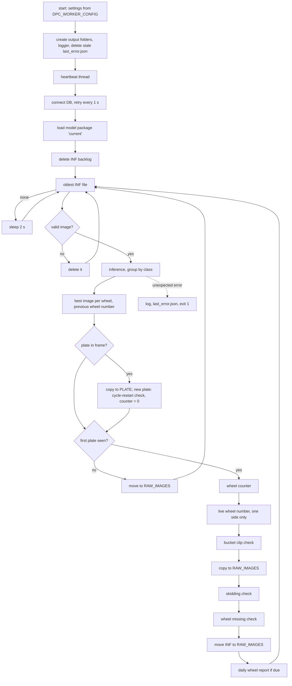

# Inspection worker: the shared program (STATUS P7, D-069)

One program, `inspection.py`, runs twice under the Supervisor: as `inspection_left` (CAM1) and `inspection_right` (CAM2). Each instance reads its rendered config `<root>/config/rendered/inspection_<side>.json` (CONTRACTS 13) from env `DPC_WORKER_CONFIG`.

The logic is that of `LeftAlgorithm.py`, the reference (D-069). Changes are only those decided in D-073 (D3 to D9) and the move from hardcoded values to config. Old line numbers (`L:<n>`, `R:<n>`) and bug numbers (`B<n>`) refer to `LEGACY_ANALYSIS.md`, the P7a analysis of the old files.

`LeftAlgorithm.py`, `RightAlgorithm.py` and the XML examples stay in the repo until Tadipatri runs the new program. They are used by the equivalence test and the replay, and are not run by the Supervisor.

## 1. Files
| File | What it does |
|---|---|
| `inspection.py` | entry point: settings, logger, DB, model, main loop, stop and error exit |
| `settings.py` | reads and checks the rendered JSON; a missing or wrong key stops the program with the key's name |
| `model.py` | model package that `current` points to (sha256-checked, CONTRACTS 12); Detectron2 setup; inference; label mapping |
| `tracking.py` | wheel counter (`motion` rtl / ltr) and plate tracker |
| `check_bucket_clip.py` | full and half bucket clip bolt check |
| `check_skidding.py` | wheel rotation (skidding), magnet-not-seen diagnostics |
| `check_wheel_missing.py` | wheel missing (the reference pattern) |
| `check_cycle_restart.py` | short revolution at a new plate |
| `defects.py` | `defects_table` access and the shared defect steps; live wheel number |
| `wheel_report.py` | best image per wheel and the daily copy |
| `heartbeat.py` | MQTT heartbeat (D-034) |
| `last_error.py` | `<root>/run/<worker_id>.last_error.json` (D-073 D7) |
| `helpers.py` | geometry, image boxes, dated folders, frame-name times |
| `tests/` | unit tests and the old-vs-new equivalence test (no GPU needed) |

## 2. Flow

## 3. Lifecycle
- **Start** (`inspection.main`):
  1. Read the settings. Create every output folder of `paths` plus `<root>/run`, so `wheel_status_images` exists before F23 lands (D-075).
  2. Logger: `<paths.logs>/<worker_id>.log`, midnight rotation, `log.backup_count`, level INFO as before.
  3. Delete an old `last_error.json` of this worker: the file always describes the last exit.
  4. Start the heartbeat.
  5. Connect to the DB, retrying every second (as before; waiting counts as alive).
  6. Load the model.
  7. Delete the `INF` backlog (unchanged, L:2299-2304).
  8. Start the loop. Nothing is inspected before the first plate.
- **Stop:** SIGTERM or SIGINT. The current frame is finished, then the program exits 0. During the DB wait the stop is immediate.
- **Unexpected error** (D-073 D7), anywhere: the error is logged with its traceback, `last_error.json` is written, and the program exits 1. There is **no in-process restart** any more (old B8). The Supervisor restarts the program under `restart_cost: high`.
  - **Config errors.** A config that cannot be read also writes `last_error.json`. Root and worker id are then taken from the config path `<root>/config/rendered/<worker_id>.json`.
  - **What counts as an unexpected error.** Same set as before: everything that used to restart inspection in-process.
  - **Exceptions logged and not fatal** (unchanged):
    - file move or copy errors for `RAW_IMAGES` and `PLATE`;
    - the live wheel-number write;
    - saving a wheel-missing defect (as in the reference pattern);
    - a DB error inside the dedupe query (it counts as "not found"; the following insert then fails and is fatal).
- **`last_error.json`:** `{at, type, message, where, traceback (last 12 lines)}`. `where` is the deepest line in this program's own code, e.g. `defects.py:62 in insert`, not a line inside pymysql. The DB and MQTT passwords are replaced by `***`. Written atomically.
- **Heartbeat:** `dpc/worker/<worker_id>/health` every 10 s.
  - Fields: `worker_id`, `healthy`, `pid`, `version` (`git describe`), `config_hash` (first 12 hex of `_generated.sha256`), `fps` (frames processed per second over the last 60 s), `inf_queue_depth`, `last_frame_age_s`.
  - `healthy` is false when the main loop has not turned for 60 s, for example a hung GPU call. An empty `INF` still turns the loop.
  - The broker comes from the JSON `mqtt` block (F25; `user`/`password` null = no login). A file without the block (rendered before F25), or no paho-mqtt, means the program logs "Heartbeat off" once and runs without a heartbeat. Inspection never depends on the broker (D-034).

## 4. Settings used (rendered JSON, CONTRACTS 13)
| Key | Used for |
|---|---|
| `worker_id`, `side`, `defect_side`, `camera_id` | log file, heartbeat topic, `last_error` name; `defect_side` = `defects_table.defect_side` (`Left` / `Right`); `side` is the prefix of magnet images |
| `writes_live_wheel_counter` | D3: only this side writes `wheel_counter_table` |
| `paths.inf` | work queue |
| `paths.raw` | frames moved out of `INF`; skidding evidence source; best-image paths |
| `paths.defect_raw`, `paths.defective`, `paths.repeated` | defect images (section 8) |
| `paths.plate`, `paths.magnet`, `paths.bolt_data`, `paths.wheel_status_images` | plate frames, magnet-not-seen frames, bolt candidates, daily wheel report |
| `paths.root`, `paths.logs` | `run/` (last_error), log |
| `paths.temp` | not used (the old TEMP folder was never read) |
| `log.backup_count` | log rotation (was hardcoded 7) |
| `model.name`, `model.models_dir` | the package `current` points to |
| `threshold` | `SCORE_THRESH_TEST` (the second fixed 0.5 filter stays, B4) |
| `machine.total_wheel_count` | wheel-count gate of defects |
| `machine.expected_cycle_total` | cycle-restart check (D8; was 65 Left / 188 Right) |
| `wheel_report.daily_time` | time of the daily copy (D4) |
| `object_sizes.bucket_clip_w`, `object_sizes.half_bucket_clip_w` | minimum clip widths |
| `motion` | wheel-counter direction (Left `rtl`, Right `ltr`) |
| `bucket_clip_window`, `half_bucket_clip_window` | clip pixel windows (per side, D5) |
| `tracker.*` | every tracker value (section 5 to 7), per side, today's values (D-073 D5) |
| `tracker.best_image_band_x` | wheel-centre band for the best image per wheel (F25; default 400..850 = Right's R:2981, both sides) |
| `db` | DB connection |
| `mqtt` | heartbeat broker (F25) |

Not used: `object_sizes.wheel_w`, `wheel_h`, `chain_w` (as before), `auto_roi` (D-054, not built), `plc` (inspection never talks to the PLC).

Every value comes from the JSON; the last constant (the best-image band) became `tracker.best_image_band_x` in F25.

## 5. Detection, wheel counting, plate and cycle
- **Detection** (`model.py`), as L:166-239.
  - Mask R-CNN from the package `current` points to: weights, Detectron yaml, `classes.json` order, every file sha256-checked first.
  - `SCORE_THRESH_TEST = threshold`, then a fixed `score > 0.5` filter (B4).
  - Output per object: `[score, ymin, ymax, xmin, xmax, class_name]`. Masks are not used.
  - Label mapping: the package `label_map`, then the old `changeLabelName` mapping (`dusty_*` and others; none of these names is a Tadipatri class).
  - Detections are grouped by mapped name and keep the model's own name at index 5, as before.
- **Wheel counter** (`tracking.WheelCounter`), on `wheel` + `half_wheel`.
  - `rtl` (Left, L:1775-1818): the leftmost `xmin` with a low watermark. A new wheel when `xmin` > watermark + `tracker.new_wheel_jump_px`.
  - `ltr` (Right, R:1906-1935): the rightmost `xmax` with a high watermark. A new wheel when `xmax` < watermark − jump.
  - The watermark is never cleared, not even at a plate (B6).
- **Plate** (`tracking.PlateTracker`, D-077): the same watermark rule as the wheel counter, in the same `motion` direction, with `tracker.new_plate_jump_px`. One physical plate = one new plate.
  - `ltr` (Right): the rightmost `xmax`, high watermark; new when it drops more than the jump below it. Unchanged (L:2208-2243).
  - `rtl` (Left): the leftmost `xmin`, low watermark; new when it rises more than the jump above it. Before D-077 Left used the `ltr` rule (B5): a plate moving left was "new" again every 150 px of travel, which reset the cycle several times and gave false `Batch_Wheels_Missing` at wheel 1.
  - Every frame with `plate` or `plate_area` is copied to `paths.plate`.
  - At a new plate: the cycle-restart check (section 6), counter = 0, and this frame's wheels are ignored.
- **Before the first plate:** frames are inferred, then moved to `RAW_IMAGES` without counting or checks.

## 6. Checks
- **Full bucket clip** (`check_bucket_clip`, L:598-764, unchanged).
  - Candidate: width > `bucket_clip_w`, inside `bucket_clip_window`, no `high_dusty_bucket_clip` within `tracker.high_dusty_suppress_px`.
  - Bolts: `nut_bolt` centre x between the clip's xmin and xmax.
  - Fewer than 2 bolts: the frame is copied to `paths.bolt_data` (B10), and the candidate is buffered per frame name.
  - Confirmed when `clip_confirm.frames` candidates have at least `min_pairs` consecutive pairs below `max_gap_ms` and `max_dist_px`. The centroid argument order is kept (B2).
  - The buffer is cleared only after an insert (B11). Wheel-count gate applies.
- **Half bucket clip** (L:766-886, unchanged). Checked only when a `half_high_dusty_bucket_clip` is detected (B3); that class is not in the Tadipatri model, so it never runs there. When it runs: window `half_bucket_clip_window`, width > `half_bucket_clip_w`, fewer than 1 bolt = defect at once, no wheel-count gate.
- **Skidding** (`check_skidding`, L:1246-1604, detection unchanged; reporting new, D9).
  - Magnet matched to its wheel; reference point = a `wheel_bolt` in the wheel, else the wheel centre + `offset_px`.
  - The track resets on:
    - a time gap of `time_gap_reset_ms` or more;
    - another wheel;
    - a wheel that did not move (belt stopped: never a defect);
    - a vertical magnet jump.
  - Over `window_frames` frames on a wheel inside `wheel_xmin..wheel_xmax`, a magnet travel below `min_magnet_travel_px` = `Wheel_Skidding`, reported through the shared steps (section 7).
  - The last up to 6 frames are copied as evidence into `DEFECTIVE/<date>/<time>/`, **only for a new defect**. Before, they were copied every time.
  - With no magnet, a `wheel` wider than `magnet_check_min_wheel_w` is saved to `paths.magnet/<date>/<SIDE><wheel>_<time>.jpg` (diagnostics, not a defect).
- **Wheel missing** (`check_wheel_missing`, the reference pattern = L:1919-2092 with the insert, D9).
  - Per wheel number, frames with no wheel are counted and buffered.
  - A gap of `min_frames`..`belt_stop_frames` frames is `WheelMissing`, judged when a wheel appears again or the counter moves to the next number. More frames = belt stopped, cancelled.
  - Box `tracker.wheel_missing.bbox`.
  - `is_reported` is never reset (D-073 D9 note): each wheel number is reported at most once per process run (B7).
- **Cycle restart** (`check_cycle_restart`, D9). At a new plate, when the revolution that ended counted more than 0 but fewer than `expected_cycle_total` wheels: `Batch_Wheels_Missing`, wheel number = last count, box (0, 0, 0, 0). The image is a copy of the plate frame. Longer cycles are not reported (as before).
- **Wheel stand:** off. The old fixed maps are not carried over; P10b builds the learned version (D8).
- **Not carried over (never called before):** chain, gap and wheel-bolt checks, the cropped second model, `is_plate_detected`, the stand logic; Right's `checkCroppedImg` and `saveAndInsertDefect`. They stay in the old files and in git history (LEGACY_ANALYSIS.md 7.3).

## 7. Defects (`defects.DefectStore.record`, the D9 pattern)
For every type, in this order:
1. **In-memory repeated check.** The list is empty: the `repeated_defects_table` lookup stays disabled, L:2340.
2. **Otherwise the 24 h dedupe** (same wheel + type + side; the size condition compares the box with itself, D-044), and, where the check asks for it, `wheel <= total_wheel_count`.
3. **New:** `defect_raw/<YYYYMMDD>/RAW_<time>_<type>_<wheel>.jpg`, then the boxed image `defective/<YYYYMMDD>/<time>_<type><wheel>.jpg`, then the `defects_table` row (side, type, image path, wheel, box). Images come before the row (CONTRACTS 4.1).
4. **Otherwise** both images go to `repeated/<YYYYMMDD>/<wheel>/`.

| Type | Check | Wheel gate | DB row before P7 | Now |
|---|---|---|---|---|
| `Nut_Bolt_Missing_In_Bucket_Clip` | full clip | yes | Left only (Right's insert was commented out) | both sides (D6) |
| `Nut_Bolt_Missing_In_Bucket_Clip` | half clip | no | (unreachable) | both sides (unreachable at Tadipatri) |
| `Wheel_Skidding` | skidding | yes | no, images only | yes (D9) |
| `WheelMissing` | wheel missing | yes | no, images only | yes (D9) |
| `Batch_Wheels_Missing` | cycle restart | yes | no, image `RESTART_AT_<n>.jpg` | yes (D9) |

The mail sender sends every unsent row of any type, so all of them are now mailed. SQL text is unchanged (f-strings, B14). Boxes accumulate on the frame when one frame has several defects (B12).

**Live wheel number (D3):** the side with `writes_live_wheel_counter: true` runs `UPDATE wheel_counter_table SET WHEEL_COUNT = %s WHERE ID = 1` whenever its counter changes, including 0 at each plate, as R:2782-2803 and R:3093-3095. Tadipatri: Right.

**Daily wheel report (D4, both sides):**
- For every `wheel` detection, the frame becomes the best image of the previous frame's wheel number (as R:2957-3015) when the wheel centre is inside `tracker.best_image_band_x`, or when the previous best image is gone.
- During the minute of `daily_time`, the list is written to `wheel_status_images/wheel.txt` and each best image is copied to `wheel_status_images/<YYYY-MM-DD>/wheel_<n>_<frame>.jpg`.
- Fix (D4): a best image that no longer exists, or the empty initial entry for wheel 1, is skipped with one warning instead of crashing.
- Unchanged: a day with no frame during that minute has no report.

## 8. Files and folders
- `INF` files are read (`imread`), copied from (`bolt_data`, `PLATE`, `RAW_IMAGES`), moved (to `RAW_IMAGES`) or deleted. They are never modified in place (D-031, Q12).
- Every image write creates a new file in an output folder.
- Output folders are created at start when missing.

## 9. In-memory state (lost on every restart)
| State | Where | Effect when lost |
|---|---|---|
| first plate seen | `Inspection.plate_found` | no inspection until the next plate (up to one revolution) |
| wheel counter, watermark | `WheelCounter` | numbering restarts at the next plate |
| plate watermark | `PlateTracker` | next plate counts as the first |
| clip candidates | `BucketClipCheck.candidates` | a confirmation in progress needs new frames |
| skidding track, evidence names | `SkiddingCheck` | 3 new frames needed |
| wheel-missing slots incl. buffered frames, `is_reported` | `WheelMissingCheck.history` | gaps in progress forgotten; reported wheel numbers can be reported again |
| best image per wheel | `WheelReport.best` | the next daily report holds only images seen since the start |
| last live wheel number written | `Inspection.live_counter_written` | written again at the first change |
| wheel detections list | `Inspection.wheel_present` | grows forever, never read (B9, kept) |
| `INF` backlog | folder | deleted at every start (unchanged) |

## 10. Bugs and oddities: what P7 changed and what stays
- **Changed by D-073:**
  - **B1:** skidding, wheel missing and cycle restart now create rows (D9).
  - **B8:** no in-process restart (D7). Hardcoded paths are gone, so the Maihar-path crash cannot happen.
  - **B13:** config errors are named, and the program stops at start.
  - **B16:** cycle total from config (D8).
  - **R2:** the best-image crash is fixed (D4).
  - **R7/R8:** gone; both sides run the same code.
  - **B5:** fixed by D-077 (P7-fix): the plate tracker follows `motion`.
- **Kept on purpose** (developer instruction, P7): B2, B3, B4, B6, B7 (`is_reported`, D9 note), B9, B10, B11, B12, B14, B17 (log texts), B19 (each frame decoded twice).
- **New observation, kept:** a frame is deleted as invalid when it is less than 0.03 s old (L:503-526, `is_valid_image`). With the atomic hand-off (D-031) a fresh `INF` link can be that young, so a frame can be lost. It is rare at 4 fps. Fix: skip the frame instead of deleting it; developer decision.

## 11. Tests
- **`python3 -m unittest discover -s workers/inspection/tests -t .`** (repo root, no GPU, no DB): 32 tests.
  - Settings from the real renderer: Tadipatri per-side values; a missing key is named.
  - Wheel counter in both directions; plate tracker: one plate crossing = one new plate, on both sides (D-077).
  - D-077 through the real frame flow: a plate crossing the Left camera with a wheel in view gives one reset and no `Batch_Wheels_Missing`; the next plate gives one, with the right count. (With the old B5 rule the same test gives 4 resets and a false restart at wheel 1.)
  - `tracker.best_image_band_x` read from the JSON and used by the best-image choice.
  - Clip confirmation per side, half-clip rule.
  - Wheel missing: gap, short gap, belt stop, previous slot.
  - Skidding: skid, rotating wheel, stopped belt.
  - Cycle restart, defect store (new / duplicate / gate), daily report skip.
  - The frame flow with a fake detector (plate gating, moves, live counter on Right only).
  - `last_error.json` (scrubbed, config-error case, `where` in own code), heartbeat payload.
- **`test_equivalence.py`:** the old functions of `LeftAlgorithm.py` / `RightAlgorithm.py` (Detectron2 stubbed) and the new classes get the same random detection sequences. Results are identical for:
  - wheel counter (3,000 frames, both directions); plate on Right against the old plate code; plate on Left against the old Left *wheel* rule fed with plates, which is what D-077 asks for (the old Left plate code is B5, deliberately different now);
  - bucket-clip inserts (6,000 frames per side; Right compared with its saved images, since its insert was commented out);
  - wheel-missing slots;
  - skidding findings.
- **`tests/replay/replay_inspection.py`** (site machine, GPU): the same saved frames through the old program and the new one, each with a scratch DB. Bolt defects are compared and new types listed.
  - The old program comes from git, with paths redirected to `/tmp`, and with the deliberate changes applied to the scratch copy: D-077 (plate rule) on LEFT, D6 (insert on) on RIGHT.
  - See `tests/replay/README.md`.
- **Smoke tests on 2026-10-26** (real MariaDB, real mosquitto, scripted fake detector, 900 frames per side):
  - Replay LEFT PASS: 23/23 bolt defects, plus 6 `WheelMissing` and 6 `Wheel_Skidding`.
  - Replay RIGHT PASS: 15/15 bolt defects, plus 1 `WheelMissing` and 5 `Wheel_Skidding`.
  - Heartbeat received from the broker and accepted by the Supervisor's `parse_heartbeat` with all extended fields.
  - SIGTERM: exit 0, no `last_error.json`.
  - `defects_table` gone mid-run: exit 1, `last_error.json` with `ProgrammingError` at `defects.py:62 in insert`, no password in it.
  - DB down at start: the program waits and retries (does not exit).
